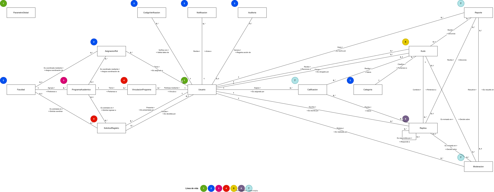
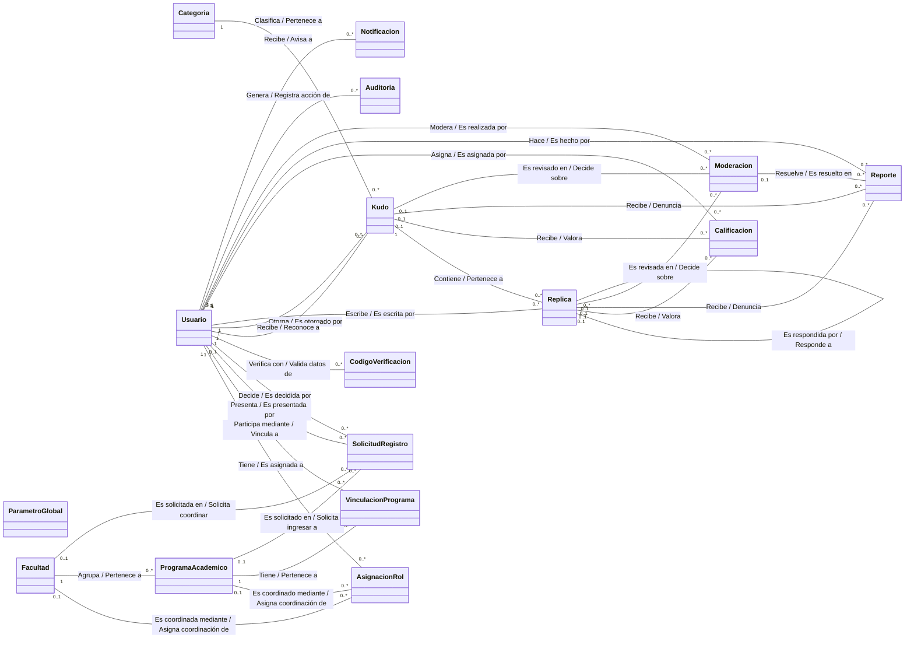

# Modelo de dominio

[Inicio](../../README.md) · [Diagrama de clases](../02-diagrama-clases/README.md) · [Modelo entidad-relación](../03-modelo-entidad-relacion/README.md) · [Casos de uso](../04-diagrama-casos-uso/README.md)

Modelo de dominio de UCO Kudos: objetos de dominio, su línea de vida, sus relaciones y, para cada objeto, su muestreo, caracterización, eventos y políticas.

## Modelo anémico y modelo enriquecido

El enunciado pide primero un **modelo anémico** y luego un **modelo enriquecido** (doc. 01 §12, doc. 06 §21-22). Siguiendo el formato del curso, los dos viven en la página de cada objeto:

| Sección de la página del objeto | Corresponde a | Qué contiene |
|---|---|---|
| **Muestreo** + diagrama de línea de vida | Modelo anémico | Entidades, atributos, tipos, obligatoriedad, datos de muestra, relaciones y cardinalidades. Sin comportamiento. |
| **Caracterización** (reglas de atributos, combinaciones únicas, responsabilidades) | Modelo enriquecido | Qué representa el objeto, qué hace, qué información necesita, con quién colabora y qué reglas protege. |
| **Eventos** | Modelo enriquecido | Event Storming: actor, acción, objeto, información externa, políticas y evento resultante. |
| **Políticas** | Modelo enriquecido | Reglas de negocio que el objeto debe asegurar, con su código. |

## Diagrama (línea de vida)

> Haz clic en la imagen para verla en tamaño completo. También disponible en [PNG](../../assets/diagramas/modelo-dominio.png). Fuente editable en draw.io: [`fuentes/modelo-dominio.drawio`](../../fuentes/modelo-dominio.drawio).

Los números en círculos de colores indican la **línea de vida**: el orden en que cada objeto puede crearse según los objetos de los que depende obligatoriamente. Cada relación se lee en los dos sentidos: el verbo con `->` se lee del primer objeto al segundo y el verbo con `<-` en sentido contrario. La distribución se eligió para minimizar los cruces: la parte organizacional (Facultad, Programa, AsignacionRol, SolicitudRegistro, VinculacionPrograma) no tiene ninguno, y la parte de contenido tiene uno solo (Kudo–Moderacion con Replica–Reporte). Ese cruce es inevitable: Usuario, Kudo y Replica se relacionan los tres con Calificacion, Reporte y Moderacion, y esa estructura (el grafo bipartito completo K3,3) no se puede dibujar en un plano sin al menos un cruce.

Versión en texto del diagrama (Mermaid)

## Objetos de dominio

| Objeto | Descripción | Línea de vida |
|---|---|:---:|
| [Usuario](objetos/Usuario.md) | Persona de la comunidad universitaria que tiene una cuenta en la plataforma. Su rol institucional vigente se conoce por su AsignacionRol vigente. | 1 |
| [ParametroGlobal](objetos/ParametroGlobal.md) | Valor de configuración de la plataforma que administran los Administradores (RN-130, D-11). | 1 |
| [AsignacionRol](objetos/AsignacionRol.md) | Registro histórico de cada rol institucional que ha tenido un usuario. Para los coordinadores también indica qué Facultad o Programa acompaña. Solo una asignación por usuario puede estar vigente. | 2 |
| [CodigoVerificacion](objetos/CodigoVerificacion.md) | Código temporal que se envía al correo o al celular de un usuario para validar que le pertenece. | 2 |
| [Facultad](objetos/Facultad.md) | Unidad académica de la Universidad que agrupa Programas Académicos y es acompañada por un Coordinador de Facultad. | 2 |
| [Categoria](objetos/Categoria.md) | Clasificación institucional de los reconocimientos (RN-132). Puede estar activa o inactiva; solo las activas se usan para Kudos nuevos. | 2 |
| [Auditoria](objetos/Auditoria.md) | Registro histórico e inmutable de una operación relevante realizada en la plataforma. Permite reconstruir quién hizo qué, cuándo, sobre qué objeto y por qué. | 2 |
| [Notificacion](objetos/Notificacion.md) | Aviso dentro de la aplicación dirigido a un usuario sobre algo que le concierne. | 2 |
| [ProgramaAcademico](objetos/ProgramaAcademico.md) | Programa de formación que pertenece a exactamente una Facultad y es acompañado por un Coordinador de Programa. | 3 |
| [VinculacionPrograma](objetos/VinculacionPrograma.md) | Vínculo, con historial, entre un Docente o Estudiante y un Programa Académico. Resuelve la relación muchos a muchos y conserva la trazabilidad de vinculaciones y desvinculaciones. | 4 |
| [SolicitudRegistro](objetos/SolicitudRegistro.md) | Petición que hace una persona al registrarse para obtener un rol institucional. La decide (aprueba o rechaza) la autoridad que corresponde según la cadena de aprobación. | 4 |
| [Kudo](objetos/Kudo.md) | Reconocimiento formal que una persona otorga a otra persona de la comunidad universitaria. Es la raíz de su conversación. | 5 |
| [Replica](objetos/Replica.md) | Intervención en la conversación de un Kudo. Su padre es el Kudo (réplica de primer nivel) u otra réplica (respuesta). | 6 |
| [Calificacion](objetos/Calificacion.md) | Valoración de 1 a 5 estrellas que un usuario asigna a un Kudo o a una réplica. Cada usuario tiene como máximo una calificación activa por contenido. | 7 |
| [Reporte](objetos/Reporte.md) | Solicitud de revisión que un usuario hace sobre un Kudo o una réplica que considera inapropiado. | 7 |
| [Moderacion](objetos/Moderacion.md) | Revisión y decisión institucional sobre un Kudo o una réplica, tomada por el Rector o el Coordinador Académico. El histórico de vetos son las moderaciones con decisión VETAR. | 7 |

Cada objeto tiene una página con cuatro secciones: **Muestreo** (atributos y datos de ejemplo), **Caracterización** (reglas de cada atributo y responsabilidades), **Eventos** (Event Storming) y **Políticas** (reglas de negocio que debe asegurar).

## Reglas de negocio

Resumen de las reglas que dan forma al modelo. El catálogo completo, regla por regla y con la política que la garantiza (RN-001 a RN-250, INV-001 a INV-035, POL-001 a POL-007), está en [reglas de negocio](../00-analisis/reglas-de-negocio.md). Las decisiones que resuelven sus vacíos están en [decisiones de diseño](../00-analisis/decisiones-de-diseno.md).

1. Toda persona entra con identidad institucional verificada: correo institucional y celular únicos y validados (RN-069 a RN-083).
2. Una cuenta solo está activa si está aprobada y tiene correo y celular verificados (RN-084 a RN-089).
3. Cada solicitud la aprueba la autoridad que corresponde: Estudiante y Docente → Coord. de Programa; Coord. de Programa → Coord. de Facultad; Coord. de Facultad → Coord. Académico; Coord. Académico → Rector. Al Rector y a los Administradores los registra un Administrador (RN-090 a RN-095, D-03). Nadie se aprueba a sí mismo (RN-108).
4. Una persona tiene un solo rol vigente y los roles son excluyentes (RN-001 a RN-038, D-13).
5. Hay un único Rector, un único Coordinador Académico y un único coordinador por Facultad y por Programa (INV-001 a INV-004).
6. Todo Programa pertenece a exactamente una Facultad; una Facultad sin Programas solo existe mientras se conforma (RN-045, RN-049, D-05).
7. Docentes y Estudiantes pueden pertenecer a varios Programas; vincular y desvincular conserva historial (RN-053 a RN-065).
8. Cada autoridad actúa solo dentro de su ámbito (POL-004, RN-112 a RN-131).
9. Solo Administrador, Rector y Coordinador Académico gestionan categorías; una categoría inactiva no sirve para Kudos nuevos, pero los Kudos antiguos la conservan (RN-132 a RN-145, D-01).
10. Todo Kudo tiene un autor, un destinatario distinto del autor, una categoría activa, fecha y contenido completo sin límite de longitud (RN-146 a RN-155, D-19).
11. Las réplicas forman un árbol de profundidad ilimitada cuyo padre es un Kudo u otra réplica, sin ciclos (RN-161 a RN-174, INV-025 a INV-029).
12. Cada persona tiene como máximo una calificación activa de 1 a 5 estrellas por contenido, y no califica su propio contenido (RN-175 a RN-185, D-23).
13. Cualquier usuario activo puede reportar contenido ajeno con un motivo (RN-186 a RN-190, D-24).
14. Solo el Rector y el Coordinador Académico revisan y vetan contenido; el contenido vetado deja de admitir interacción (RN-191 a RN-200, RN-243 a RN-248, D-02, D-21).
15. Toda operación relevante queda auditada y nada se borra físicamente (RN-096 a RN-100, RN-249, RN-250, D-26, D-28).
16. Quién creó o modificó un objeto se conoce por la auditoría y no se repite como atributo en cada entidad (D-31).

## Agregados

Un agregado es el conjunto de objetos que cambia junto dentro de una misma transacción; su raíz es la única puerta de entrada y protege las reglas del conjunto. En la arquitectura del curso, cada operación de la fachada abre una transacción que modifica un agregado (o los que coordina un servicio de dominio).

| Agregado | Raíz | Objetos internos | Por qué ese límite |
|---|---|---|---|
| Usuario | [Usuario](objetos/Usuario.md) | AsignacionRol, CodigoVerificacion | La identidad y el ciclo de vida de la cuenta cambian juntos: activar exige mirar la aprobación y las dos verificaciones; un código o una asignación no tienen sentido sin su usuario. |
| Facultad | [Facultad](objetos/Facultad.md) | ProgramaAcademico | La regla "una Facultad sin programas solo existe mientras se conforma" (RN-045) y la activación al crear el primer programa cruzan los dos objetos. |
| SolicitudRegistro | [SolicitudRegistro](objetos/SolicitudRegistro.md) | — | Tiene su propio ciclo de vida (pendiente, aprobada, rechazada) y la deciden autoridades distintas al solicitante. |
| VinculacionPrograma | [VinculacionPrograma](objetos/VinculacionPrograma.md) | — | Relaciona dos agregados (Usuario y Facultad/Programa) y tiene historial propio; la gestiona el coordinador del programa. |
| Categoria | [Categoria](objetos/Categoria.md) | — | Su activación no depende de ningún otro objeto. |
| Kudo | [Kudo](objetos/Kudo.md) | — | Protege su propio ciclo de vida. Las réplicas no se incluyen porque la conversación es ilimitada (RN-163). |
| Replica | [Replica](objetos/Replica.md) | — | Cada réplica cambia de estado por separado; el árbol se arma al consultarlo (Composite). |
| Calificacion | [Calificacion](objetos/Calificacion.md) | — | Muchas personas califican el mismo contenido al tiempo; separarla evita bloquear el Kudo. El promedio se actualiza mediante el evento de calificación. |
| Reporte | [Reporte](objetos/Reporte.md) | — | Lo crea cualquier usuario y lo resuelve la moderación. |
| Moderacion | [Moderacion](objetos/Moderacion.md) | — | Registra la decisión; el ServicioModeracion coordina en la misma transacción el contenido y sus reportes. |
| Auditoria | [Auditoria](objetos/Auditoria.md) | — | Inmutable; solo se crea. |
| Notificacion | [Notificacion](objetos/Notificacion.md) | — | Pertenece a un destinatario y solo cambia al leerse. |
| ParametroGlobal | [ParametroGlobal](objetos/ParametroGlobal.md) | — | Configuración independiente. |

## Servicios de dominio y políticas transversales

Responsabilidades que no pertenecen a una sola entidad (doc. 06 §29): coordinan varios agregados o expresan una regla que usan muchos casos de uso.

| Servicio / política | Responsabilidad | Por qué no está en una entidad | Políticas |
|---|---|---|---|
| `ServicioAprobacion` | Aprobar una solicitud de registro | La aprobación toca varios agregados en una transacción: SolicitudRegistro (decisión), Usuario (aprobar y activar), AsignacionRol (rol y posible sustitución del coordinador anterior) y VinculacionPrograma (docentes y estudiantes). Ninguno de ellos debería conocer a los demás. | P-SRE-008, P-ASR-004 |
| `ServicioModeracion` | Iniciar revisión, vetar y liberar contenido | Una decisión de moderación cambia la Moderacion, el estado del Kudo o la réplica y todos sus reportes abiertos. Coordinarlo en un servicio mantiene a cada objeto responsable solo de su estado. | P-MOD-003, P-MOD-006, P-MOD-008 |
| `PoliticaAmbito` | Decidir si un actor puede actuar sobre un usuario, una Facultad o un Programa | Implementa la matriz de gestión y los ámbitos de autoridad (RN-112 a RN-131). Es una especificación (patrón Specification) reutilizada por varios casos de uso. | P-USU-022, P-VPR-003, P-SRE-006 |
| `PoliticaModeracion` | Decidir si un actor puede moderar | Solo Rector y Coordinador Académico (D-02). | P-MOD-001 |
| `PoliticaGestionCategorias` | Decidir si un actor puede gestionar categorías | Solo Administrador, Rector y Coordinador Académico (D-01). | P-CAT-003 |
| `PublicadorEventos` | Entregar cada evento de dominio a sus suscriptores | Patrón Observer: los suscriptores AuditoriaSuscriptor, NotificacionSuscriptor e IndicadorSuscriptor reaccionan sin que el negocio los conozca (D-26). | P-AUD-001 |
| `EnviadorNotificacion` | Enviar códigos por correo o SMS | Interfaz hacia el exterior (evento de integración). La implementación de este proyecto es simulada (D-10). | P-CVE-004 |

## Catálogo de eventos de dominio

Cada evento lo produce una responsabilidad de un objeto. El publicador de eventos lo entrega a la auditoría, a las notificaciones y a los indicadores (D-26). La columna *Referencia* indica el código del enunciado (EVT-xxx del doc. 06 y RN-213 a RN-242 del doc. 05).

| Evento | Objeto | Responsabilidad | Actor | Referencia |
|---|---|---|---|---|
| Parámetro global modificado | [ParametroGlobal](objetos/ParametroGlobal.md#eventos) | Cambiar valor | Administrador | RN-130 |
| Código de verificación generado | [CodigoVerificacion](objetos/CodigoVerificacion.md#eventos) | Generar código | Sistema | Evento de integración |
| Correo o celular verificado | [CodigoVerificacion](objetos/CodigoVerificacion.md#eventos) | Verificar código | Usuario registrado | EVT-002, EVT-003 |
| Código invalidado | [CodigoVerificacion](objetos/CodigoVerificacion.md#eventos) | Invalidar código | Sistema |  |
| Notificación creada | [Notificacion](objetos/Notificacion.md#eventos) | Crear notificación | Sistema (suscriptor de notificaciones) |  |
| Notificación leída | [Notificacion](objetos/Notificacion.md#eventos) | Marcar como leída | Usuario activo |  |
| Operación auditada | [Auditoria](objetos/Auditoria.md#eventos) | Registrar operación | Sistema (suscriptor de auditoría) | RN-096 a RN-100 |
| Categoría creada | [Categoria](objetos/Categoria.md#eventos) | Crear categoría | Gestor de categorías | EVT-020 / RN-224 |
| Categoría modificada | [Categoria](objetos/Categoria.md#eventos) | Modificar categoría | Gestor de categorías | EVT-021 / RN-225 |
| Categoría activada | [Categoria](objetos/Categoria.md#eventos) | Activar categoría | Gestor de categorías | EVT-022 / RN-226 |
| Categoría desactivada | [Categoria](objetos/Categoria.md#eventos) | Desactivar categoría | Gestor de categorías | EVT-023 / RN-227 |
| Facultad creada | [Facultad](objetos/Facultad.md#eventos) | Crear Facultad | Coordinador Académico | EVT-008 / RN-218 |
| Facultad modificada | [Facultad](objetos/Facultad.md#eventos) | Renombrar Facultad | Coordinador Académico | RF-017 |
| Facultad activada | [Facultad](objetos/Facultad.md#eventos) | Activar Facultad | Sistema (al crear un programa) |  |
| Facultad inactivada | [Facultad](objetos/Facultad.md#eventos) | Inactivar Facultad | Coordinador Académico |  |
| Rol asignado / coordinador asignado | [AsignacionRol](objetos/AsignacionRol.md#eventos) | Asignar rol | Sistema (al aprobar o registrar) | EVT-010, EVT-012, EVT-014, EVT-015, RN-219, RN-222 |
| Asignación cerrada / coordinador reemplazado | [AsignacionRol](objetos/AsignacionRol.md#eventos) | Cerrar asignación | Sistema (sustitución o desactivación) | EVT-011, EVT-013, RN-220, RN-223 |
| Usuario registrado | [Usuario](objetos/Usuario.md#eventos) | Registrar usuario | Persona no registrada | EVT-001 / RN-213 |
| Usuario registrado y Rector asignado | [Usuario](objetos/Usuario.md#eventos) | Registrar Rector o Administrador | Administrador | EVT-001, EVT-004, EVT-015 |
| Correo verificado | [Usuario](objetos/Usuario.md#eventos) | Verificar correo | Usuario registrado | EVT-002 |
| Celular verificado | [Usuario](objetos/Usuario.md#eventos) | Verificar celular | Usuario registrado | EVT-003 |
| Usuario aprobado | [Usuario](objetos/Usuario.md#eventos) | Aprobar cuenta | Sistema (desde ServicioAprobacion) | EVT-004 / RN-214 |
| Cuenta activada | [Usuario](objetos/Usuario.md#eventos) | Activar cuenta | Sistema | EVT-005 / RN-215 |
| Sesión iniciada | [Usuario](objetos/Usuario.md#eventos) | Iniciar sesión | Usuario registrado |  |
| Datos personales modificados | [Usuario](objetos/Usuario.md#eventos) | Actualizar datos personales | Usuario activo | RN-109 |
| Correo modificado | [Usuario](objetos/Usuario.md#eventos) | Cambiar correo | Usuario activo | RN-083, RN-110 |
| Celular modificado | [Usuario](objetos/Usuario.md#eventos) | Cambiar celular | Usuario activo | RN-083, RN-111 |
| Cuenta suspendida | [Usuario](objetos/Usuario.md#eventos) | Suspender cuenta | Autoridad | EVT-006 / RN-216 |
| Cuenta activada | [Usuario](objetos/Usuario.md#eventos) | Reactivar cuenta | Autoridad | EVT-005 |
| Cuenta desactivada | [Usuario](objetos/Usuario.md#eventos) | Desactivar cuenta | Autoridad | EVT-007 / RN-217 |
| Kudo creado (publicado) | [Kudo](objetos/Kudo.md#eventos) | Crear Kudo | Usuario activo | EVT-024 / RN-228 |
| Kudo consultado | [Kudo](objetos/Kudo.md#eventos) | Consultar Kudo | Usuario activo | EVT-025 / RN-229 |
| Kudo reportado | [Kudo](objetos/Kudo.md#eventos) | Marcar reportado | Sistema (al crear un reporte) | EVT-026 / RN-230 |
| Revisión iniciada | [Kudo](objetos/Kudo.md#eventos) | Iniciar revisión | Sistema (desde ServicioModeracion) | EVT-035 / RN-239 |
| Contenido liberado | [Kudo](objetos/Kudo.md#eventos) | Liberar Kudo | Sistema (desde ServicioModeracion) | EVT-037 / RN-242 |
| Kudo vetado | [Kudo](objetos/Kudo.md#eventos) | Vetar Kudo | Sistema (desde ServicioModeracion) | EVT-027 / RN-231 |
| Indicador recalculado | [Kudo](objetos/Kudo.md#eventos) | Actualizar resumen de calificaciones | Sistema (suscriptor de calificaciones) | EVT-034 / RN-238 |
| Programa creado | [ProgramaAcademico](objetos/ProgramaAcademico.md#eventos) | Crear Programa | Coordinador Académico | EVT-009 / RN-221 |
| Programa modificado | [ProgramaAcademico](objetos/ProgramaAcademico.md#eventos) | Renombrar Programa | Coordinador Académico | RF-022 |
| Programa inactivado | [ProgramaAcademico](objetos/ProgramaAcademico.md#eventos) | Inactivar Programa | Coordinador Académico |  |
| Solicitud de registro creada | [SolicitudRegistro](objetos/SolicitudRegistro.md#eventos) | Crear solicitud | Persona no registrada | RN-213 |
| Usuario aprobado | [SolicitudRegistro](objetos/SolicitudRegistro.md#eventos) | Aprobar solicitud | Autoridad | EVT-004 / RN-214 |
| Solicitud rechazada | [SolicitudRegistro](objetos/SolicitudRegistro.md#eventos) | Rechazar solicitud | Autoridad |  |
| Estudiante o docente vinculado a programa | [VinculacionPrograma](objetos/VinculacionPrograma.md#eventos) | Vincular a programa | Coordinador de Programa | EVT-016, EVT-018 |
| Estudiante o docente desvinculado de programa | [VinculacionPrograma](objetos/VinculacionPrograma.md#eventos) | Desvincular de programa | Coordinador de Programa | EVT-017, EVT-019 |
| Réplica creada | [Replica](objetos/Replica.md#eventos) | Responder Kudo | Usuario activo | EVT-028 / RN-232 |
| Réplica creada y réplica respondida | [Replica](objetos/Replica.md#eventos) | Responder réplica | Usuario activo | EVT-028, EVT-029 / RN-233 |
| Réplica reportada | [Replica](objetos/Replica.md#eventos) | Marcar reportada | Sistema (al crear un reporte) | EVT-030 / RN-234 |
| Revisión iniciada | [Replica](objetos/Replica.md#eventos) | Iniciar revisión | Sistema (desde ServicioModeracion) | EVT-035 / RN-239 |
| Contenido liberado | [Replica](objetos/Replica.md#eventos) | Liberar réplica | Sistema (desde ServicioModeracion) | EVT-037 / RN-242 |
| Réplica vetada | [Replica](objetos/Replica.md#eventos) | Vetar réplica | Sistema (desde ServicioModeracion) | EVT-031 / RN-235 |
| Indicador recalculado | [Replica](objetos/Replica.md#eventos) | Actualizar resumen de calificaciones | Sistema (suscriptor de calificaciones) | EVT-034 / RN-238 |
| Calificación registrada | [Calificacion](objetos/Calificacion.md#eventos) | Calificar contenido | Usuario activo | EVT-032 / RN-236 |
| Calificación actualizada | [Calificacion](objetos/Calificacion.md#eventos) | Modificar calificación | Usuario activo | EVT-033 / RN-237 |
| Revisión iniciada | [Moderacion](objetos/Moderacion.md#eventos) | Iniciar revisión | Moderador | EVT-035 / RN-239 |
| Contenido vetado y revisión cerrada | [Moderacion](objetos/Moderacion.md#eventos) | Vetar contenido | Moderador | EVT-027, EVT-031, EVT-036, EVT-038, RN-241 |
| Contenido liberado y revisión cerrada | [Moderacion](objetos/Moderacion.md#eventos) | Liberar contenido | Moderador | EVT-036, EVT-037, RN-242 |
| Kudo reportado / réplica reportada | [Reporte](objetos/Reporte.md#eventos) | Reportar contenido | Usuario activo | EVT-026, EVT-030 |
| Revisión iniciada | [Reporte](objetos/Reporte.md#eventos) | Pasar a revisión | Sistema (desde ServicioModeracion) | EVT-035 |
| Revisión cerrada | [Reporte](objetos/Reporte.md#eventos) | Aceptar reporte | Sistema (desde ServicioModeracion) | EVT-036 |
| Revisión cerrada | [Reporte](objetos/Reporte.md#eventos) | Rechazar reporte | Sistema (desde ServicioModeracion) | EVT-036 |

## Resumen del modelo enriquecido

| Objeto | Tipo | Responsabilidades | Políticas propias |
|---|---|:---:|:---:|
| [ParametroGlobal](objetos/ParametroGlobal.md) | Entidad raíz de agregado | 3 | 4 |
| [CodigoVerificacion](objetos/CodigoVerificacion.md) | Entidad interna de agregado | 3 | 8 |
| [Notificacion](objetos/Notificacion.md) | Entidad raíz de agregado | 3 | 3 |
| [Auditoria](objetos/Auditoria.md) | Entidad raíz de agregado (inmutable) | 3 | 6 |
| [Categoria](objetos/Categoria.md) | Entidad raíz de agregado | 5 | 8 |
| [Facultad](objetos/Facultad.md) | Entidad raíz de agregado | 5 | 8 |
| [AsignacionRol](objetos/AsignacionRol.md) | Entidad interna de agregado | 4 | 8 |
| [Usuario](objetos/Usuario.md) | Entidad raíz de agregado | 15 | 29 |
| [Kudo](objetos/Kudo.md) | Entidad raíz de agregado | 10 | 18 |
| [ProgramaAcademico](objetos/ProgramaAcademico.md) | Entidad interna de agregado | 4 | 8 |
| [SolicitudRegistro](objetos/SolicitudRegistro.md) | Entidad raíz de agregado | 4 | 11 |
| [VinculacionPrograma](objetos/VinculacionPrograma.md) | Entidad raíz de agregado | 4 | 9 |
| [Replica](objetos/Replica.md) | Entidad raíz de agregado | 9 | 14 |
| [Calificacion](objetos/Calificacion.md) | Entidad raíz de agregado | 3 | 9 |
| [Moderacion](objetos/Moderacion.md) | Entidad raíz de agregado | 4 | 9 |
| [Reporte](objetos/Reporte.md) | Entidad raíz de agregado | 5 | 10 |
| **Total** | | **84** | **162** |

## ¿Por qué Rector, Docente, Estudiante… no son clases?

El enunciado pide analizar Usuario, Estudiante, Docente, Rector, Coordinador Académico, Coordinador de Facultad y Coordinador de Programa (doc. 06 §23). Se modelan como **roles** de un `Usuario` mediante `AsignacionRol`, no como subclases:

| Alternativa | Problema |
|---|---|
| Herencia (`Estudiante extends Usuario`) | Un objeto no puede cambiar de clase. Si un coordinador es reemplazado (D-15) o alguien cambia de rol, habría que destruir el objeto y crear otro, y se perdería la continuidad de su historial (Kudos, calificaciones, auditoría). |
| Un booleano por rol (`esRector`, `esDocente`…) | Permite combinaciones prohibidas (RN-001 a RN-038) y obliga a validar 30 incompatibilidades. |
| **Composición: `Usuario` + `AsignacionRol` (elegida)** | El rol es un dato con vigencia. Solo puede haber **una asignación vigente** por usuario (UQ-ASR-1), así que la exclusividad de roles se cumple **por construcción** (D-13). Las mismas asignaciones guardan el historial de roles y de coordinadores (RN-043, RN-051). |

| Concepto del enunciado | Cómo se representa |
|---|---|
| Administrador, Rector, Coordinador Académico | `Usuario` con `AsignacionRol` vigente de ese rol |
| Coordinador de Facultad | `AsignacionRol` con rol `COORDINADOR_FACULTAD` + `facultad` |
| Coordinador de Programa | `AsignacionRol` con rol `COORDINADOR_PROGRAMA` + `programa` |
| Docente / Estudiante | `AsignacionRol` con rol `DOCENTE`/`ESTUDIANTE` + uno o más `VinculacionPrograma` vigentes |
| Historial de coordinadores | Asignaciones vigentes y cerradas de esa Facultad o Programa |

## Relaciones y cardinalidades

| # | Objeto | Card. | Se lee (->) | Objeto | Card. | Se lee (<-) | Tipo |
|---|---|:---:|---|---|:---:|---|---|
| 1 | [Usuario](objetos/Usuario.md) | 1 | Tiene-> | [AsignacionRol](objetos/AsignacionRol.md) | 0..* | <-Es asignada a | Composición |
| 2 | [Facultad](objetos/Facultad.md) | 0..1 | Es coordinada mediante-> | [AsignacionRol](objetos/AsignacionRol.md) | 0..* | <-Asigna coordinación de | Asociación |
| 3 | [ProgramaAcademico](objetos/ProgramaAcademico.md) | 0..1 | Es coordinado mediante-> | [AsignacionRol](objetos/AsignacionRol.md) | 0..* | <-Asigna coordinación de | Asociación |
| 4 | [Facultad](objetos/Facultad.md) | 1 | Agrupa-> | [ProgramaAcademico](objetos/ProgramaAcademico.md) | 0..* | <-Pertenece a | Composición |
| 5 | [Usuario](objetos/Usuario.md) | 1 | Participa mediante-> | [VinculacionPrograma](objetos/VinculacionPrograma.md) | 0..* | <-Vincula a | Asociación |
| 6 | [ProgramaAcademico](objetos/ProgramaAcademico.md) | 1 | Tiene-> | [VinculacionPrograma](objetos/VinculacionPrograma.md) | 0..* | <-Pertenece a | Asociación |
| 7 | [Usuario](objetos/Usuario.md) | 1 | Presenta-> | [SolicitudRegistro](objetos/SolicitudRegistro.md) | 0..* | <-Es presentada por | Asociación |
| 8 | [Usuario](objetos/Usuario.md) | 0..1 | Decide-> | [SolicitudRegistro](objetos/SolicitudRegistro.md) | 0..* | <-Es decidida por | Asociación |
| 9 | [Facultad](objetos/Facultad.md) | 0..1 | Es solicitada en-> | [SolicitudRegistro](objetos/SolicitudRegistro.md) | 0..* | <-Solicita coordinar | Asociación |
| 10 | [ProgramaAcademico](objetos/ProgramaAcademico.md) | 0..1 | Es solicitado en-> | [SolicitudRegistro](objetos/SolicitudRegistro.md) | 0..* | <-Solicita ingresar a | Asociación |
| 11 | [Usuario](objetos/Usuario.md) | 1 | Verifica con-> | [CodigoVerificacion](objetos/CodigoVerificacion.md) | 0..* | <-Valida datos de | Composición |
| 12 | [Usuario](objetos/Usuario.md) | 1 | Otorga-> | [Kudo](objetos/Kudo.md) | 0..* | <-Es otorgado por | Asociación |
| 13 | [Usuario](objetos/Usuario.md) | 1 | Recibe-> | [Kudo](objetos/Kudo.md) | 0..* | <-Reconoce a | Asociación |
| 14 | [Categoria](objetos/Categoria.md) | 1 | Clasifica-> | [Kudo](objetos/Kudo.md) | 0..* | <-Pertenece a | Asociación |
| 15 | [Kudo](objetos/Kudo.md) | 1 | Contiene-> | [Replica](objetos/Replica.md) | 0..* | <-Pertenece a | Composición |
| 16 | [Replica](objetos/Replica.md) | 0..1 | Es respondida por-> | [Replica](objetos/Replica.md) | 0..* | <-Responde a | Asociación |
| 17 | [Usuario](objetos/Usuario.md) | 1 | Escribe-> | [Replica](objetos/Replica.md) | 0..* | <-Es escrita por | Asociación |
| 18 | [Kudo](objetos/Kudo.md) | 0..1 | Recibe-> | [Calificacion](objetos/Calificacion.md) | 0..* | <-Valora | Asociación |
| 19 | [Replica](objetos/Replica.md) | 0..1 | Recibe-> | [Calificacion](objetos/Calificacion.md) | 0..* | <-Valora | Asociación |
| 20 | [Usuario](objetos/Usuario.md) | 1 | Asigna-> | [Calificacion](objetos/Calificacion.md) | 0..* | <-Es asignada por | Asociación |
| 21 | [Kudo](objetos/Kudo.md) | 0..1 | Recibe-> | [Reporte](objetos/Reporte.md) | 0..* | <-Denuncia | Asociación |
| 22 | [Replica](objetos/Replica.md) | 0..1 | Recibe-> | [Reporte](objetos/Reporte.md) | 0..* | <-Denuncia | Asociación |
| 23 | [Usuario](objetos/Usuario.md) | 1 | Hace-> | [Reporte](objetos/Reporte.md) | 0..* | <-Es hecho por | Asociación |
| 24 | [Kudo](objetos/Kudo.md) | 0..1 | Es revisado en-> | [Moderacion](objetos/Moderacion.md) | 0..* | <-Decide sobre | Asociación |
| 25 | [Replica](objetos/Replica.md) | 0..1 | Es revisada en-> | [Moderacion](objetos/Moderacion.md) | 0..* | <-Decide sobre | Asociación |
| 26 | [Usuario](objetos/Usuario.md) | 1 | Modera-> | [Moderacion](objetos/Moderacion.md) | 0..* | <-Es realizada por | Asociación |
| 27 | [Moderacion](objetos/Moderacion.md) | 0..1 | Resuelve-> | [Reporte](objetos/Reporte.md) | 0..* | <-Es resuelto en | Asociación |
| 28 | [Usuario](objetos/Usuario.md) | 0..1 | Genera-> | [Auditoria](objetos/Auditoria.md) | 0..* | <-Registra acción de | Asociación |
| 29 | [Usuario](objetos/Usuario.md) | 1 | Recibe-> | [Notificacion](objetos/Notificacion.md) | 0..* | <-Avisa a | Asociación |

**Composiciones** (la parte no existe sin el todo): `Usuario ◆— AsignacionRol`, `Usuario ◆— CodigoVerificacion`, `Facultad ◆— ProgramaAcademico` y `Kudo ◆— Replica`. Como nada se borra físicamente (D-28), la composición expresa pertenencia, no borrado en cascada.

**"O uno o el otro"**: `Calificacion`, `Reporte` y `Moderacion` apuntan a un Kudo **o** a una réplica, nunca a ambos ni a ninguno. Se modelan con dos referencias opcionales y la restricción "exactamente una" (`CHECK` en base de datos), en lugar de una referencia genérica `tipo + id` que no permite llaves foráneas (ARQ-064).

**Árbol de réplicas**: la relación reflexiva `Replica 0..1 — 0..* Replica` forma el árbol de profundidad ilimitada (RN-164). Cada réplica guarda también su `kudo` raíz para leer la conversación completa en una sola consulta.

### Matriz de cardinalidades del enunciado (doc. 10 §9)

| Concepto | Cardinalidad | Dónde se garantiza |
|---|:---:|---|
| Rector por Universidad | 1 | UQ-ASR-2 |
| Coordinador Académico por Universidad | 1 | UQ-ASR-3 |
| Coordinador de Facultad por Facultad | 1 | UQ-ASR-4 |
| Coordinador de Programa por Programa | 1 | UQ-ASR-5 |
| Docentes / Estudiantes por Programa | N | `VinculacionPrograma` |
| Programas por Docente / Estudiante | N | `VinculacionPrograma` |
| Facultades por Programa | exactamente 1 | INV-008, RN-049 |
| Roles vigentes por persona | 0..1 | UQ-ASR-1 |
| Autor / destinatario / categoría por Kudo | exactamente 1 | INV-020, INV-021, INV-023 |
| Padre por réplica | exactamente 1 (Kudo o réplica) | INV-026, INV-027 |
| Calificaciones activas por persona y contenido | 0..1 | UQ-CAL-1, UQ-CAL-2 |

## Enumeraciones

Conjuntos cerrados de valores. En el código son `enum` de Java; en la base de datos, columnas de texto con restricción `CHECK`.

### Rol

Rol institucional. Cada valor conoce qué rol lo aprueba.

| Valor | Significado |
|---|---|
| `ADMINISTRADOR` | Lo registra otro Administrador |
| `RECTOR` | Lo registra un Administrador |
| `COORDINADOR_ACADEMICO` | Lo aprueba el Rector |
| `COORDINADOR_FACULTAD` | Lo aprueba el Coordinador Académico |
| `COORDINADOR_PROGRAMA` | Lo aprueba el Coordinador de Facultad de la Facultad del programa |
| `DOCENTE` | Lo aprueba el Coordinador del Programa (D-03) |
| `ESTUDIANTE` | Lo aprueba el Coordinador del Programa |

### EstadoCuenta

Ciclo de vida de la cuenta (D-17).

| Valor | Significado |
|---|---|
| `PENDIENTE_APROBACION` | Registrada, esperando la decisión de la autoridad |
| `PENDIENTE_VERIFICACION` | Aprobada, pero falta verificar correo y/o celular |
| `ACTIVA` | Aprobada y con correo y celular verificados: puede ingresar |
| `SUSPENDIDA` | Bloqueada temporalmente; puede reactivarse |
| `DESACTIVADA` | Cerrada de forma definitiva para su rol; conserva historial |

### EstadoFacultad

Ciclo de vida de la Facultad (D-05).

| Valor | Significado |
|---|---|
| `EN_CONFORMACION` | Creada, aún sin programas |
| `ACTIVA` | Con al menos un programa |
| `INACTIVA` | Fuera de operación; se conserva su historia |

### TipoVinculo

Calidad del vínculo con el programa.

| Valor | Significado |
|---|---|
| `DOCENTE` | Enseña en el programa |
| `ESTUDIANTE` | Estudia el programa |

### EstadoSolicitud

Estados de la solicitud de registro.

| Valor | Significado |
|---|---|
| `PENDIENTE` | Esperando decisión |
| `APROBADA` | Aceptada por la autoridad |
| `RECHAZADA` | Rechazada con motivo |

### CanalVerificacion

Dato de contacto que se verifica.

| Valor | Significado |
|---|---|
| `CORREO` | Correo institucional |
| `CELULAR` | Número celular |

### EstadoContenido

Ciclo de vida de Kudos y réplicas (D-20).

| Valor | Significado |
|---|---|
| `CREADO` | Recién construido, aún no publicado |
| `VISIBLE` | Publicado y disponible para interacción |
| `REPORTADO` | Tiene al menos un reporte pendiente; sigue visible |
| `EN_REVISION` | Un moderador lo está revisando |
| `VETADO` | Inhabilitado por moderación (estado final) |

### MotivoReporte

Motivos de reporte (CU-010).

| Valor | Significado |
|---|---|
| `LENGUAJE_OFENSIVO` | Lenguaje ofensivo |
| `ACOSO` | Acoso |
| `DISCRIMINACION` | Discriminación |
| `SPAM` | Spam |
| `INFORMACION_FALSA` | Información falsa |
| `OTRO` | Otro (exige descripción) |

### EstadoReporte

Estados del reporte (RN-210 a RN-212).

| Valor | Significado |
|---|---|
| `PENDIENTE` | Recién creado |
| `EN_REVISION` | Incluido en una moderación en curso |
| `ACEPTADO` | La moderación vetó el contenido |
| `RECHAZADO` | La moderación liberó el contenido |

### EstadoModeracion

Estados de la moderación.

| Valor | Significado |
|---|---|
| `EN_CURSO` | Revisión abierta |
| `CERRADA` | Decisión tomada |

### DecisionModeracion

Decisión del moderador.

| Valor | Significado |
|---|---|
| `VETAR` | El contenido se veta |
| `LIBERAR` | El contenido vuelve a VISIBLE |

### TipoNotificacion

Tipos de aviso (D-27).

| Valor | Significado |
|---|---|
| `KUDO_RECIBIDO` | Le otorgaron un Kudo |
| `REPLICA_RECIBIDA` | Respondieron su Kudo o su réplica |
| `SOLICITUD_APROBADA` | Su solicitud fue aprobada |
| `SOLICITUD_RECHAZADA` | Su solicitud fue rechazada |
| `SOLICITUD_PENDIENTE` | Tiene una solicitud por decidir (para la autoridad) |
| `CONTENIDO_VETADO` | Un contenido suyo fue vetado |
| `CODIGO_VERIFICACION` | Código para verificar correo o celular |
| `CUENTA_SUSPENDIDA` | Su cuenta fue suspendida |
| `CUENTA_REACTIVADA` | Su cuenta fue reactivada |

### TipoParametro

Tipo de dato de un parámetro global.

| Valor | Significado |
|---|---|
| `TEXTO` | Valor textual |
| `ENTERO` | Número entero |

## Objetos de valor

Atributos con reglas propias. Son inmutables y se validan al construirse, así que nunca existe uno inválido.

| Objeto de valor | Usado en | Regla que encapsula |
|---|---|---|
| `CorreoInstitucional` | Usuario.correoInstitucional | Formato de correo, dominio institucional, normalizado a minúsculas |
| `NumeroCelular` | Usuario.numeroCelular | 10 dígitos, inicia en 3 |
| `ContenidoTexto` | Kudo.contenido, Replica.contenido | No vacío, sin límite de longitud, nunca se trunca |
| `Estrellas` | Calificacion.estrellas | Entero de 1 a 5 |

## Convenciones

- **Identificadores**: UUID generados por la aplicación, igual que en Sigma.
- **Nada se borra físicamente** (D-28): vigencias (`fechaInicio`, `fechaFin`), estados y banderas `activo` conservan la historia.
- **Fechas**: zona horaria de Colombia (UTC-5).
- **Texto**: se guarda sin espacios al inicio ni al final.

