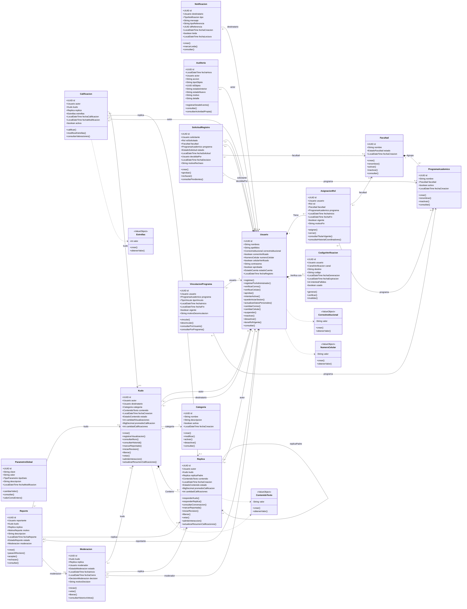

# Diagrama de clases

[Inicio](../../README.md) · [Modelo de dominio](../01-modelo-dominio/README.md) · [Modelo entidad-relación](../03-modelo-entidad-relacion/README.md) · [Casos de uso](../04-diagrama-casos-uso/README.md)

Diagrama de clases del dominio y documentación de cada clase, igual que en Sigma: relaciones, atributos, constructores, métodos accesores, métodos de negocio y su `Builder`.

## Diagrama

> Haz clic en la imagen para verla en tamaño completo. También disponible en [PNG](../../assets/diagramas/diagrama-clases.png). Fuente editable en draw.io: [`fuentes/diagrama-clases.drawio`](../../fuentes/diagrama-clases.drawio).

**Cómo leerlo**

- Flecha abierta: navegabilidad. La clase que guarda la referencia apunta a la clase referenciada; la etiqueta indica el atributo, por ejemplo `Kudo --> Categoria : categoria`.
- Rombo relleno: composición; la parte pertenece al todo.
- Los objetos de valor (verde) y las enumeraciones (amarillo) aparecen a la derecha y se usan como tipos de atributo.
- A diferencia de Sigma, los métodos no son solo `registrar/consultar`: son comportamiento del dominio (`kudo.vetar()`, `usuario.intentarActivar()`), porque el enunciado exige objetos ricos (ARQ-008, ARQ-047, D-29).

Versión en texto del diagrama (Mermaid)

### Enumeraciones

```mermaid
classDiagram
direction LR
class Rol {
  <<enumeration>>
  ADMINISTRADOR
  RECTOR
  COORDINADOR_ACADEMICO
  COORDINADOR_FACULTAD
  COORDINADOR_PROGRAMA
  DOCENTE
  ESTUDIANTE
  +rolAprobador()
}
class EstadoCuenta {
  <<enumeration>>
  PENDIENTE_APROBACION
  PENDIENTE_VERIFICACION
  ACTIVA
  SUSPENDIDA
  DESACTIVADA
}
class EstadoFacultad {
  <<enumeration>>
  EN_CONFORMACION
  ACTIVA
  INACTIVA
}
class TipoVinculo {
  <<enumeration>>
  DOCENTE
  ESTUDIANTE
}
class EstadoSolicitud {
  <<enumeration>>
  PENDIENTE
  APROBADA
  RECHAZADA
}
class CanalVerificacion {
  <<enumeration>>
  CORREO
  CELULAR
}
class EstadoContenido {
  <<enumeration>>
  CREADO
  VISIBLE
  REPORTADO
  EN_REVISION
  VETADO
}
class MotivoReporte {
  <<enumeration>>
  LENGUAJE_OFENSIVO
  ACOSO
  DISCRIMINACION
  SPAM
  INFORMACION_FALSA
  OTRO
}
class EstadoReporte {
  <<enumeration>>
  PENDIENTE
  EN_REVISION
  ACEPTADO
  RECHAZADO
}
class EstadoModeracion {
  <<enumeration>>
  EN_CURSO
  CERRADA
}
class DecisionModeracion {
  <<enumeration>>
  VETAR
  LIBERAR
}
class TipoNotificacion {
  <<enumeration>>
  KUDO_RECIBIDO
  REPLICA_RECIBIDA
  SOLICITUD_APROBADA
  SOLICITUD_RECHAZADA
  SOLICITUD_PENDIENTE
  CONTENIDO_VETADO
  CODIGO_VERIFICACION
  CUENTA_SUSPENDIDA
  CUENTA_REACTIVADA
}
class TipoParametro {
  <<enumeration>>
  TEXTO
  ENTERO
}
```

Versión en texto del diagrama (Mermaid)

> **Clases de soporte del diseño** que no aparecen en el diagrama principal para no recargarlo: `Conversacion`, `NodoConversacion` e interfaz `ContenidoConversable` (Composite), `PoliticaAmbito`, `PoliticaModeracion` y `PoliticaGestionCategorias` (Specification), `ServicioAprobacion` y `ServicioModeracion` (servicios de dominio), y `PublicadorEventos`, `EventoDominio` y sus suscriptores (Observer). Se describen en [patrones](../05-arquitectura/patrones.md).

## Clases

| Clase | Estereotipo | Descripción |
|---|---|---|
| [ParametroGlobal](clases/ParametroGlobal.md) | class | Valor de configuración de la plataforma que administran los Administradores (RN-130, D-11). |
| [CodigoVerificacion](clases/CodigoVerificacion.md) | class | Código temporal que se envía al correo o al celular de un usuario para validar que le pertenece. |
| [Notificacion](clases/Notificacion.md) | class | Aviso dentro de la aplicación dirigido a un usuario sobre algo que le concierne. |
| [Auditoria](clases/Auditoria.md) | class | Registro histórico e inmutable de una operación relevante realizada en la plataforma. Permite reconstruir quién hizo qué, cuándo, sobre qué objeto y por qué. |
| [Categoria](clases/Categoria.md) | class | Clasificación institucional de los reconocimientos (RN-132). Puede estar activa o inactiva; solo las activas se usan para Kudos nuevos. |
| [Facultad](clases/Facultad.md) | class | Unidad académica de la Universidad que agrupa Programas Académicos y es acompañada por un Coordinador de Facultad. |
| [AsignacionRol](clases/AsignacionRol.md) | class | Registro histórico de cada rol institucional que ha tenido un usuario. Para los coordinadores también indica qué Facultad o Programa acompaña. Solo una asignación por usuario puede estar vigente. |
| [Usuario](clases/Usuario.md) | class | Persona de la comunidad universitaria que tiene una cuenta en la plataforma. Su rol institucional vigente se conoce por su AsignacionRol vigente. |
| [Kudo](clases/Kudo.md) | class | Reconocimiento formal que una persona otorga a otra persona de la comunidad universitaria. Es la raíz de su conversación. |
| [ProgramaAcademico](clases/ProgramaAcademico.md) | class | Programa de formación que pertenece a exactamente una Facultad y es acompañado por un Coordinador de Programa. |
| [SolicitudRegistro](clases/SolicitudRegistro.md) | class | Petición que hace una persona al registrarse para obtener un rol institucional. La decide (aprueba o rechaza) la autoridad que corresponde según la cadena de aprobación. |
| [VinculacionPrograma](clases/VinculacionPrograma.md) | class | Vínculo, con historial, entre un Docente o Estudiante y un Programa Académico. Resuelve la relación muchos a muchos y conserva la trazabilidad de vinculaciones y desvinculaciones. |
| [Replica](clases/Replica.md) | class | Intervención en la conversación de un Kudo. Su padre es el Kudo (réplica de primer nivel) u otra réplica (respuesta). |
| [Calificacion](clases/Calificacion.md) | class | Valoración de 1 a 5 estrellas que un usuario asigna a un Kudo o a una réplica. Cada usuario tiene como máximo una calificación activa por contenido. |
| [Moderacion](clases/Moderacion.md) | class | Revisión y decisión institucional sobre un Kudo o una réplica, tomada por el Rector o el Coordinador Académico. El histórico de vetos son las moderaciones con decisión VETAR. |
| [Reporte](clases/Reporte.md) | class | Solicitud de revisión que un usuario hace sobre un Kudo o una réplica que considera inapropiado. |
| [CorreoInstitucional](clases/CorreoInstitucional.md) | value object | Formato de correo, dominio institucional, normalizado a minúsculas. Usado en Usuario.correoInstitucional. |
| [NumeroCelular](clases/NumeroCelular.md) | value object | 10 dígitos, inicia en 3. Usado en Usuario.numeroCelular. |
| [ContenidoTexto](clases/ContenidoTexto.md) | value object | No vacío, sin límite de longitud, nunca se trunca. Usado en Kudo.contenido, Replica.contenido. |
| [Estrellas](clases/Estrellas.md) | value object | Entero de 1 a 5. Usado en Calificacion.estrellas. |
| [Rol](../01-modelo-dominio/README.md#rol) | enumeration | Rol institucional. Cada valor conoce qué rol lo aprueba. |
| [EstadoCuenta](../01-modelo-dominio/README.md#estadocuenta) | enumeration | Ciclo de vida de la cuenta (D-17). |
| [EstadoFacultad](../01-modelo-dominio/README.md#estadofacultad) | enumeration | Ciclo de vida de la Facultad (D-05). |
| [TipoVinculo](../01-modelo-dominio/README.md#tipovinculo) | enumeration | Calidad del vínculo con el programa. |
| [EstadoSolicitud](../01-modelo-dominio/README.md#estadosolicitud) | enumeration | Estados de la solicitud de registro. |
| [CanalVerificacion](../01-modelo-dominio/README.md#canalverificacion) | enumeration | Dato de contacto que se verifica. |
| [EstadoContenido](../01-modelo-dominio/README.md#estadocontenido) | enumeration | Ciclo de vida de Kudos y réplicas (D-20). |
| [MotivoReporte](../01-modelo-dominio/README.md#motivoreporte) | enumeration | Motivos de reporte (CU-010). |
| [EstadoReporte](../01-modelo-dominio/README.md#estadoreporte) | enumeration | Estados del reporte (RN-210 a RN-212). |
| [EstadoModeracion](../01-modelo-dominio/README.md#estadomoderacion) | enumeration | Estados de la moderación. |
| [DecisionModeracion](../01-modelo-dominio/README.md#decisionmoderacion) | enumeration | Decisión del moderador. |
| [TipoNotificacion](../01-modelo-dominio/README.md#tiponotificacion) | enumeration | Tipos de aviso (D-27). |
| [TipoParametro](../01-modelo-dominio/README.md#tipoparametro) | enumeration | Tipo de dato de un parámetro global. |
