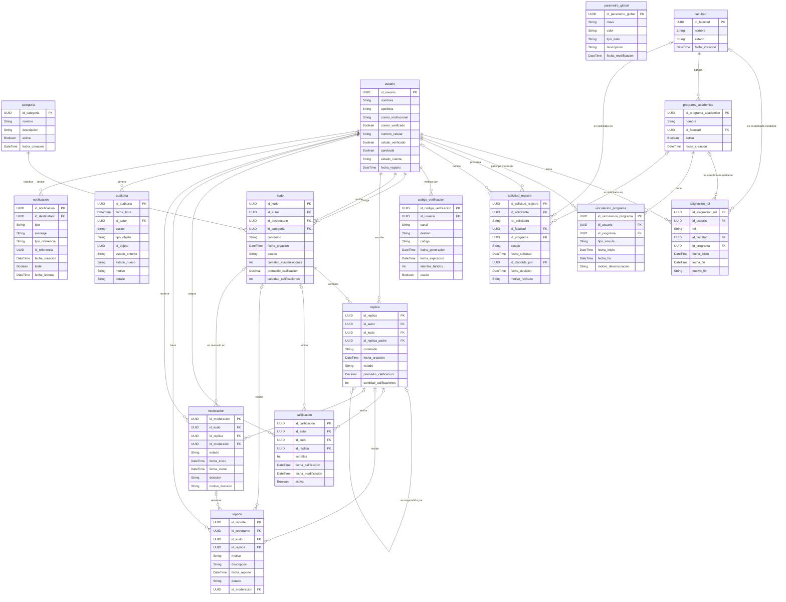

# Modelo entidad-relación (MER)

[Inicio](../../README.md) · [Modelo de dominio](../01-modelo-dominio/README.md) · [Diagrama de clases](../02-diagrama-clases/README.md) · [Casos de uso](../04-diagrama-casos-uso/README.md)

Modelo de datos relacional del sistema y diccionario de datos de cada entidad (tipos SQL Server, llaves primarias y foráneas, restricciones de unicidad, chequeo e índices), igual que en Sigma.

## Diagrama

> Haz clic en la imagen para verla en tamaño completo. También disponible en [PNG](../../assets/diagramas/mer.png). Fuente editable en draw.io: [`fuentes/mer.drawio`](../../fuentes/mer.drawio).

**Cómo leerlo**: cada tabla muestra tipo, columna y llave (PK/FK). Las relaciones usan notación de pata de gallo: dos rayas = exactamente uno, círculo y raya = cero o uno, círculo y pata de gallo = cero o muchos. En draw.io cada relación sale de la llave primaria y llega a la columna foránea que la referencia.

**Convenciones de nombres** (como en el script de Sigma): tablas en minúscula con guion bajo (`asignacion_rol`), llave primaria `id_<tabla>` y llave foránea `id_<rol>` (`id_autor`, `id_destinatario`, `id_replica_padre`). El atributo `vigente` de `AsignacionRol` y `VinculacionPrograma` no se almacena: se deriva de `fecha_fin` vacía, y los índices únicos filtrados usan `WHERE fecha_fin IS NULL` (D-14).

Versión en texto del diagrama (Mermaid)

## Entidades

| Entidad (tabla) | Objeto de dominio | Descripción |
|---|---|---|
| [`parametro_global`](entidades/ParametroGlobal.md) | [ParametroGlobal](../01-modelo-dominio/objetos/ParametroGlobal.md) | Valor de configuración de la plataforma que administran los Administradores (RN-130, D-11). |
| [`codigo_verificacion`](entidades/CodigoVerificacion.md) | [CodigoVerificacion](../01-modelo-dominio/objetos/CodigoVerificacion.md) | Código temporal que se envía al correo o al celular de un usuario para validar que le pertenece. |
| [`notificacion`](entidades/Notificacion.md) | [Notificacion](../01-modelo-dominio/objetos/Notificacion.md) | Aviso dentro de la aplicación dirigido a un usuario sobre algo que le concierne. |
| [`auditoria`](entidades/Auditoria.md) | [Auditoria](../01-modelo-dominio/objetos/Auditoria.md) | Registro histórico e inmutable de una operación relevante realizada en la plataforma. Permite reconstruir quién hizo qué, cuándo, sobre qué objeto y por qué. |
| [`categoria`](entidades/Categoria.md) | [Categoria](../01-modelo-dominio/objetos/Categoria.md) | Clasificación institucional de los reconocimientos (RN-132). Puede estar activa o inactiva; solo las activas se usan para Kudos nuevos. |
| [`facultad`](entidades/Facultad.md) | [Facultad](../01-modelo-dominio/objetos/Facultad.md) | Unidad académica de la Universidad que agrupa Programas Académicos y es acompañada por un Coordinador de Facultad. |
| [`asignacion_rol`](entidades/AsignacionRol.md) | [AsignacionRol](../01-modelo-dominio/objetos/AsignacionRol.md) | Registro histórico de cada rol institucional que ha tenido un usuario. Para los coordinadores también indica qué Facultad o Programa acompaña. Solo una asignación por usuario puede estar vigente. |
| [`usuario`](entidades/Usuario.md) | [Usuario](../01-modelo-dominio/objetos/Usuario.md) | Persona de la comunidad universitaria que tiene una cuenta en la plataforma. Su rol institucional vigente se conoce por su AsignacionRol vigente. |
| [`kudo`](entidades/Kudo.md) | [Kudo](../01-modelo-dominio/objetos/Kudo.md) | Reconocimiento formal que una persona otorga a otra persona de la comunidad universitaria. Es la raíz de su conversación. |
| [`programa_academico`](entidades/ProgramaAcademico.md) | [ProgramaAcademico](../01-modelo-dominio/objetos/ProgramaAcademico.md) | Programa de formación que pertenece a exactamente una Facultad y es acompañado por un Coordinador de Programa. |
| [`solicitud_registro`](entidades/SolicitudRegistro.md) | [SolicitudRegistro](../01-modelo-dominio/objetos/SolicitudRegistro.md) | Petición que hace una persona al registrarse para obtener un rol institucional. La decide (aprueba o rechaza) la autoridad que corresponde según la cadena de aprobación. |
| [`vinculacion_programa`](entidades/VinculacionPrograma.md) | [VinculacionPrograma](../01-modelo-dominio/objetos/VinculacionPrograma.md) | Vínculo, con historial, entre un Docente o Estudiante y un Programa Académico. Resuelve la relación muchos a muchos y conserva la trazabilidad de vinculaciones y desvinculaciones. |
| [`replica`](entidades/Replica.md) | [Replica](../01-modelo-dominio/objetos/Replica.md) | Intervención en la conversación de un Kudo. Su padre es el Kudo (réplica de primer nivel) u otra réplica (respuesta). |
| [`calificacion`](entidades/Calificacion.md) | [Calificacion](../01-modelo-dominio/objetos/Calificacion.md) | Valoración de 1 a 5 estrellas que un usuario asigna a un Kudo o a una réplica. Cada usuario tiene como máximo una calificación activa por contenido. |
| [`moderacion`](entidades/Moderacion.md) | [Moderacion](../01-modelo-dominio/objetos/Moderacion.md) | Revisión y decisión institucional sobre un Kudo o una réplica, tomada por el Rector o el Coordinador Académico. El histórico de vetos son las moderaciones con decisión VETAR. |
| [`reporte`](entidades/Reporte.md) | [Reporte](../01-modelo-dominio/objetos/Reporte.md) | Solicitud de revisión que un usuario hace sobre un Kudo o una réplica que considera inapropiado. |

Cada entidad tiene una página con su **diccionario de datos** (formato de Sigma: tipo, longitud, obligatoriedad, llaves, restricciones de unicidad, chequeo e índice, valor por defecto y descripción) y la lista de sus **restricciones** con su definición SQL.

## Decisiones del modelo físico

| Decisión | Justificación |
|---|---|
| Identificadores `uniqueidentifier` con `default newid()` | Igual que Sigma; la aplicación genera el UUID y la base lo respalda. |
| Textos con nombres de personas y contenido en `nvarchar` | Conservan tildes y ñ sin depender de la intercalación. Códigos, claves técnicas y enumeraciones en `varchar`. |
| Contenido de Kudos y réplicas en `nvarchar(max)` | RN-152, RN-153 y RN-170: sin límite de longitud y nunca se trunca. |
| Fechas en `datetime2(0)` con `default sysdatetime()` | Precisión al segundo; la fecha la asigna el sistema (RN-150, RN-169, RN-182, RN-189). |
| Enumeraciones como `varchar` + `check (... in (...))` | Igual que Sigma; los valores son fijos y legibles en la base. |
| Índices únicos filtrados (`create unique index ... where ...`) | Garantizan las reglas de "solo uno vigente/activo/abierto" sin borrar el historial: un Rector y un Coordinador Académico vigentes, un coordinador por Facultad y por Programa, un rol vigente por persona, una calificación activa y un reporte abierto por persona y contenido, una solicitud pendiente y una moderación en curso por contenido (D-14). |
| `check` de "exactamente uno" en `calificacion`, `reporte` y `moderacion` | Apuntan a un Kudo o a una réplica, nunca a ambos ni a ninguno, sin perder las llaves foráneas (ARQ-064). |
| `check` de coherencia de estados | Por ejemplo, una cuenta ACTIVA exige aprobación y las dos verificaciones (RN-088), y una moderación CERRADA exige decisión y motivo (RN-250). |
| Sin `on delete cascade` | Nada se borra físicamente (D-28). |

## Scripts SQL

Están en la carpeta [`sql/`](../../sql) de esta documentación (al implementar se copian también al repositorio del back-end) y se ejecutan en este orden:

| # | Script | Qué hace |
|---|---|---|
| 1 | [`crear-usuario-kudos.sql`](../../sql/crear-usuario-kudos.sql) | Crea la base `Kudos` y el login `kudosUser` con permisos solo de lectura y escritura de datos. |
| 2 | [`crear-tablas-kudos.sql`](../../sql/crear-tablas-kudos.sql) | Crea las 16 tablas con sus 94 restricciones y 12 índices únicos filtrados. |
| 3 | [`datos-iniciales-kudos.sql`](../../sql/datos-iniciales-kudos.sql) | Parámetros globales, primer Administrador (D-18) y categorías base. |
| 4 | [`datos-demo-kudos.sql`](../../sql/datos-demo-kudos.sql) | Opcional: estructura académica y un usuario activo de cada rol para probar y sustentar. |

## Validación de las restricciones

Los scripts se ejecutaron en SQL Server 2025 sobre una base temporal y se intentaron 16 operaciones que violan reglas de negocio. **Todas fueron rechazadas por la base de datos** con la restricción esperada (script [`sql/validar_sql.py`](../../sql/validar_sql.py)):

| Operación que debe rechazarse | Regla | Restricción que la rechazó |
|---|---|---|
| Registrar un segundo Rector vigente | INV-001 | `ux_asignacion_rol_cargo_unico_vigente` |
| Dar un segundo rol vigente a una persona | RN-001 | `ux_asignacion_rol_usuario_vigente` |
| Asignar un segundo coordinador vigente a una Facultad | INV-003 | `ux_asignacion_rol_facultad_vigente` |
| Coordinador de Facultad sin Facultad | INV-010 | `ck_asignacion_rol_ambito` |
| Cuenta ACTIVA sin verificar | RN-088 | `ck_usuario_cuenta_activa` |
| Correo institucional duplicado | RN-073 | `uk_usuario_correo_institucional` |
| Celular con formato inválido | D-12 | `ck_usuario_numero_celular` |
| Kudo a sí mismo | D-19 | `ck_kudo_autor_destinatario` |
| Kudo con contenido vacío | INV-024 | `ck_kudo_contenido` |
| Segunda calificación activa del mismo usuario | RN-180 | `ux_calificacion_kudo_activa` |
| Calificación de 6 estrellas | RN-177 | `ck_calificacion_estrellas` |
| Calificación sin contenido | RN-184 | `ck_calificacion_contenido` |
| Reporte con motivo OTRO sin descripción | RN-190 | `ck_reporte_descripcion` |
| Moderación cerrada sin motivo | RN-250 | `ck_moderacion_cierre` |
| Autoaprobación de una solicitud | RN-108 | `ck_solicitud_registro_no_autoaprobacion` |
| Segunda solicitud pendiente de la misma persona | UQ-SOL-1 | `ux_solicitud_registro_pendiente` |

**Hallazgos de la validación** (corregidos antes de entregar):

1. Los índices únicos filtrados exigen `SET QUOTED_IDENTIFIER ON`; `sqlcmd` lo trae apagado. Los scripts lo activan al inicio. El driver JDBC del back-end lo trae activo por defecto.
2. Un `check` cuyo resultado es *desconocido* (por comparar con `NULL`) **se deja pasar**. Por eso `ck_reporte_descripcion` y `ck_moderacion_cierre` aceptaban valores nulos; ahora exigen `is not null` de forma explícita.

