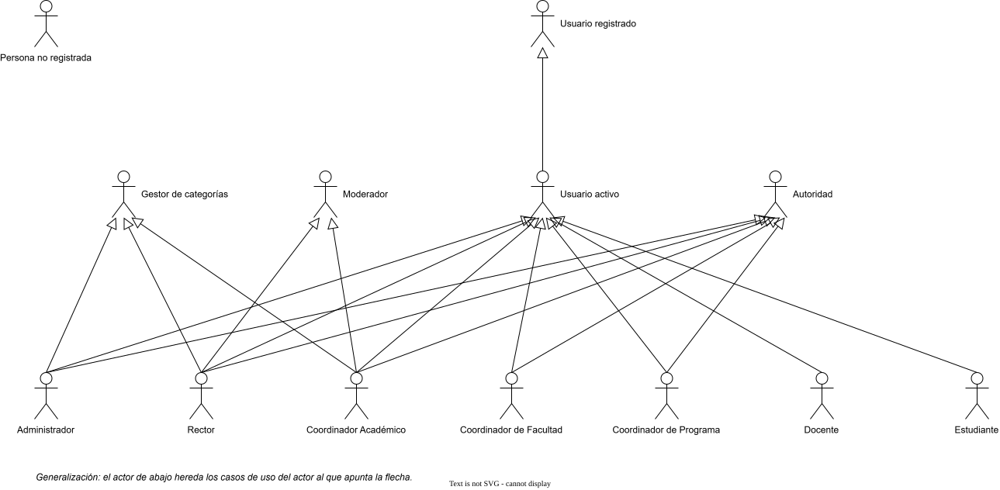
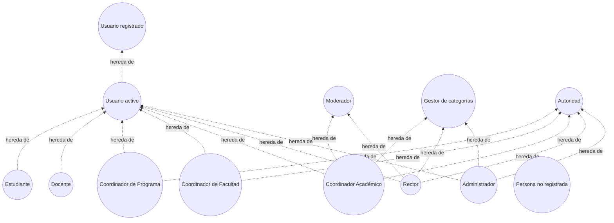
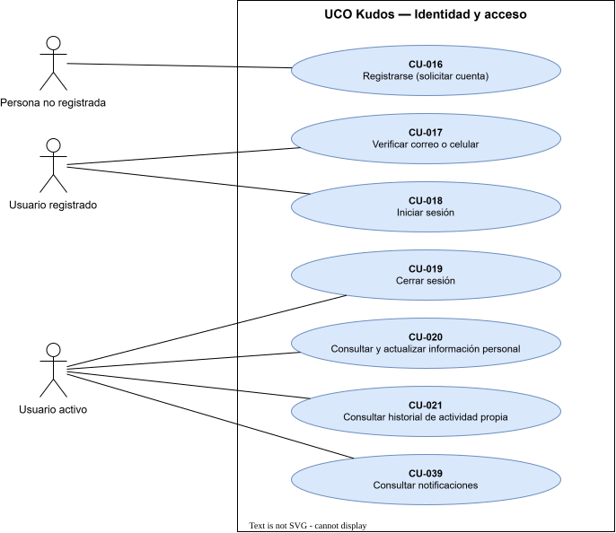
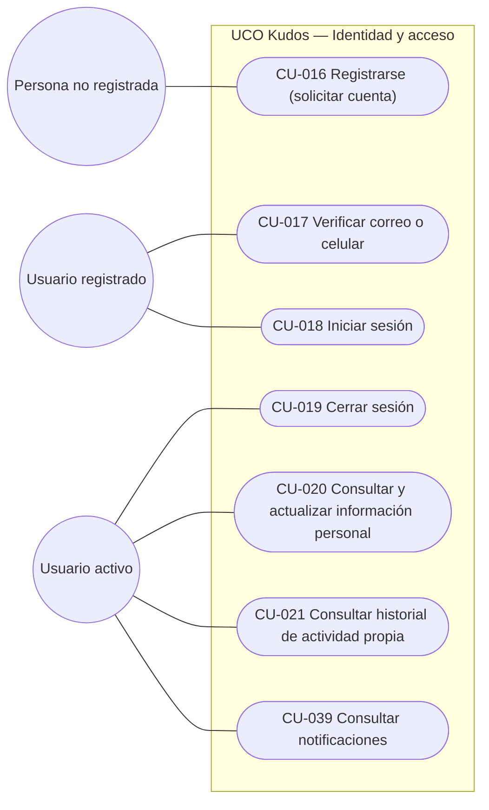
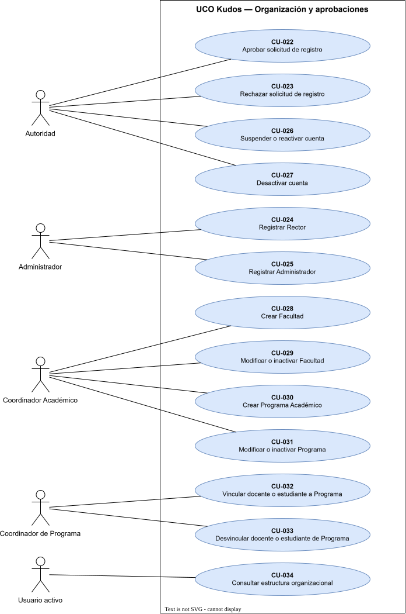
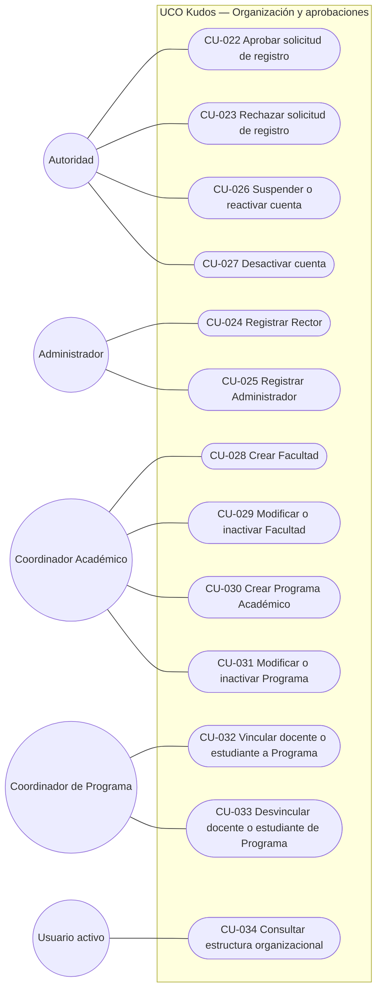
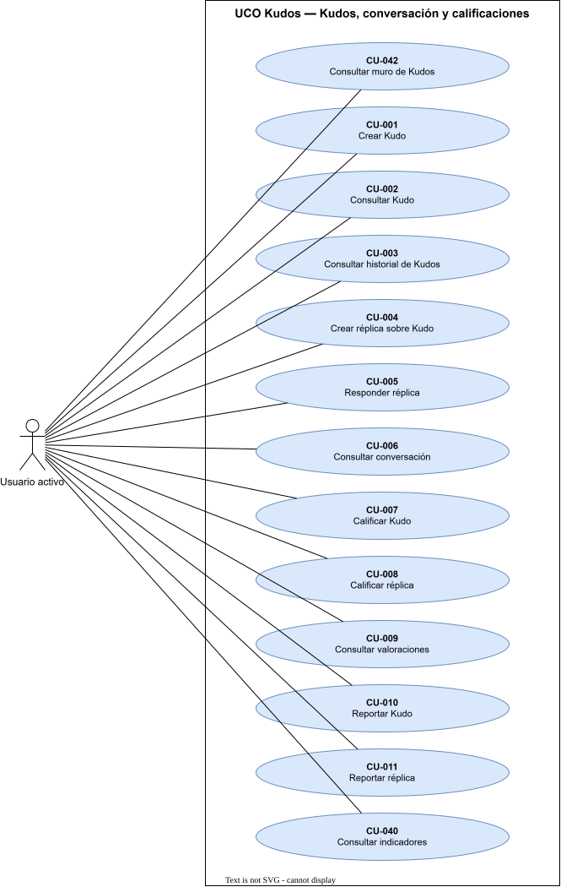
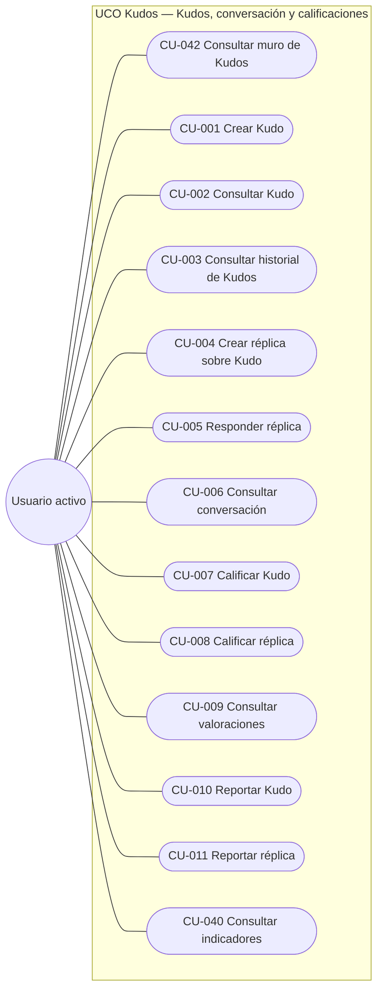
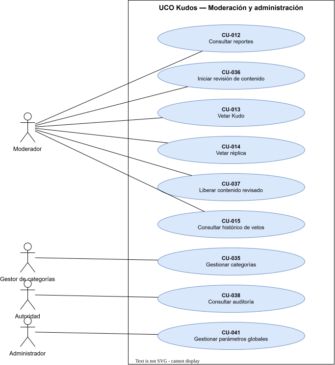
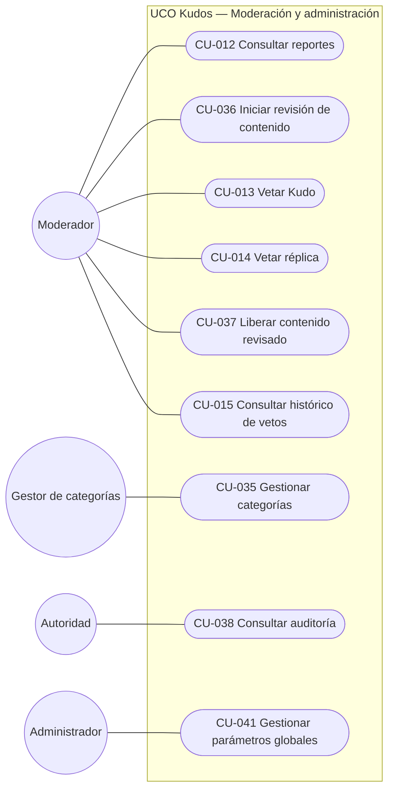

# Diagrama de casos de uso

[Inicio](../../README.md) · [Especificación de casos de uso](../00-analisis/casos-de-uso.md) · [Modelo de dominio](../01-modelo-dominio/README.md)

Diagrama UML de casos de uso de UCO Kudos (UML-001). Para que sea legible se divide en una página de actores y una página por módulo. La especificación de cada caso (precondiciones, flujos, excepciones y eventos) está en [casos-de-uso.md](../00-analisis/casos-de-uso.md).

> Fuente editable en draw.io: [`fuentes/casos-uso.drawio`](../../fuentes/casos-uso.drawio), con una página por cada sección de este documento.

## 1. Actores

| Actor | Tipo | Descripción |
|---|---|---|
| Persona no registrada | Concreto | Integrante de la comunidad que aún no tiene cuenta |
| Usuario registrado | Abstracto | Tiene cuenta, aunque todavía no esté activa (verifica datos, inicia sesión) |
| Usuario activo | Abstracto | Cuenta aprobada y verificada; lo especializan los 7 roles |
| Administrador, Rector, Coordinador Académico, Coordinador de Facultad, Coordinador de Programa, Docente, Estudiante | Concretos | Roles institucionales (doc. 01 §7) |
| Moderador | Abstracto | Rector o Coordinador Académico (D-02) |
| Gestor de categorías | Abstracto | Administrador, Rector o Coordinador Académico (D-01) |
| Autoridad | Abstracto | Quien aprueba, rechaza y gestiona cuentas dentro de su ámbito según la Matriz de aprobaciones y de gestión (doc. 10 §5-6) |

La flecha de generalización indica que el actor especializado hereda todos los casos de uso del actor general. Por ejemplo, el Rector puede hacer todo lo que hace un Usuario activo, un Moderador, un Gestor de categorías y una Autoridad.

> Haz clic en la imagen para verla en tamaño completo. También disponible en [PNG](../../assets/diagramas/casos-uso-1.png). Fuente editable en draw.io: [`fuentes/casos-uso.drawio`](../../fuentes/casos-uso.drawio).

Versión en texto del diagrama (Mermaid)

## 2. Identidad y acceso

> Haz clic en la imagen para verla en tamaño completo. También disponible en [PNG](../../assets/diagramas/casos-uso-2.png). Fuente editable en draw.io: [`fuentes/casos-uso.drawio`](../../fuentes/casos-uso.drawio).

Versión en texto del diagrama (Mermaid)

| Caso de uso | Actor |
|---|---|
| [CU-016 Registrarse (solicitar cuenta)](../00-analisis/casos-de-uso.md) | Persona no registrada |
| [CU-017 Verificar correo o celular](../00-analisis/casos-de-uso.md) | Usuario registrado |
| [CU-018 Iniciar sesión](../00-analisis/casos-de-uso.md) | Usuario registrado |
| [CU-019 Cerrar sesión](../00-analisis/casos-de-uso.md) | Usuario activo |
| [CU-020 Consultar y actualizar información personal](../00-analisis/casos-de-uso.md) | Usuario activo |
| [CU-021 Consultar historial de actividad propia](../00-analisis/casos-de-uso.md) | Usuario activo |
| [CU-039 Consultar notificaciones](../00-analisis/casos-de-uso.md) | Usuario activo |

## 3. Organización y aprobaciones

> Haz clic en la imagen para verla en tamaño completo. También disponible en [PNG](../../assets/diagramas/casos-uso-3.png). Fuente editable en draw.io: [`fuentes/casos-uso.drawio`](../../fuentes/casos-uso.drawio).

Versión en texto del diagrama (Mermaid)

| Caso de uso | Actor |
|---|---|
| [CU-022 Aprobar solicitud de registro](../00-analisis/casos-de-uso.md) | Autoridad |
| [CU-023 Rechazar solicitud de registro](../00-analisis/casos-de-uso.md) | Autoridad |
| [CU-026 Suspender o reactivar cuenta](../00-analisis/casos-de-uso.md) | Autoridad |
| [CU-027 Desactivar cuenta](../00-analisis/casos-de-uso.md) | Autoridad |
| [CU-024 Registrar Rector](../00-analisis/casos-de-uso.md) | Administrador |
| [CU-025 Registrar Administrador](../00-analisis/casos-de-uso.md) | Administrador |
| [CU-028 Crear Facultad](../00-analisis/casos-de-uso.md) | Coordinador Académico |
| [CU-029 Modificar o inactivar Facultad](../00-analisis/casos-de-uso.md) | Coordinador Académico |
| [CU-030 Crear Programa Académico](../00-analisis/casos-de-uso.md) | Coordinador Académico |
| [CU-031 Modificar o inactivar Programa](../00-analisis/casos-de-uso.md) | Coordinador Académico |
| [CU-032 Vincular docente o estudiante a Programa](../00-analisis/casos-de-uso.md) | Coordinador de Programa |
| [CU-033 Desvincular docente o estudiante de Programa](../00-analisis/casos-de-uso.md) | Coordinador de Programa |
| [CU-034 Consultar estructura organizacional](../00-analisis/casos-de-uso.md) | Usuario activo |

## 4. Kudos, conversación y calificaciones

> Haz clic en la imagen para verla en tamaño completo. También disponible en [PNG](../../assets/diagramas/casos-uso-4.png). Fuente editable en draw.io: [`fuentes/casos-uso.drawio`](../../fuentes/casos-uso.drawio).

Versión en texto del diagrama (Mermaid)

| Caso de uso | Actor |
|---|---|
| [CU-042 Consultar muro de Kudos](../00-analisis/casos-de-uso.md) | Usuario activo |
| [CU-001 Crear Kudo](../00-analisis/casos-de-uso.md) | Usuario activo |
| [CU-002 Consultar Kudo](../00-analisis/casos-de-uso.md) | Usuario activo |
| [CU-003 Consultar historial de Kudos](../00-analisis/casos-de-uso.md) | Usuario activo |
| [CU-004 Crear réplica sobre Kudo](../00-analisis/casos-de-uso.md) | Usuario activo |
| [CU-005 Responder réplica](../00-analisis/casos-de-uso.md) | Usuario activo |
| [CU-006 Consultar conversación](../00-analisis/casos-de-uso.md) | Usuario activo |
| [CU-007 Calificar Kudo](../00-analisis/casos-de-uso.md) | Usuario activo |
| [CU-008 Calificar réplica](../00-analisis/casos-de-uso.md) | Usuario activo |
| [CU-009 Consultar valoraciones](../00-analisis/casos-de-uso.md) | Usuario activo |
| [CU-010 Reportar Kudo](../00-analisis/casos-de-uso.md) | Usuario activo |
| [CU-011 Reportar réplica](../00-analisis/casos-de-uso.md) | Usuario activo |
| [CU-040 Consultar indicadores](../00-analisis/casos-de-uso.md) | Usuario activo |

## 5. Moderación y administración

> Haz clic en la imagen para verla en tamaño completo. También disponible en [PNG](../../assets/diagramas/casos-uso-5.png). Fuente editable en draw.io: [`fuentes/casos-uso.drawio`](../../fuentes/casos-uso.drawio).

Versión en texto del diagrama (Mermaid)

| Caso de uso | Actor |
|---|---|
| [CU-012 Consultar reportes](../00-analisis/casos-de-uso.md) | Moderador |
| [CU-036 Iniciar revisión de contenido](../00-analisis/casos-de-uso.md) | Moderador |
| [CU-013 Vetar Kudo](../00-analisis/casos-de-uso.md) | Moderador |
| [CU-014 Vetar réplica](../00-analisis/casos-de-uso.md) | Moderador |
| [CU-037 Liberar contenido revisado](../00-analisis/casos-de-uso.md) | Moderador |
| [CU-015 Consultar histórico de vetos](../00-analisis/casos-de-uso.md) | Moderador |
| [CU-035 Gestionar categorías](../00-analisis/casos-de-uso.md) | Gestor de categorías |
| [CU-038 Consultar auditoría](../00-analisis/casos-de-uso.md) | Autoridad |
| [CU-041 Gestionar parámetros globales](../00-analisis/casos-de-uso.md) | Administrador |
