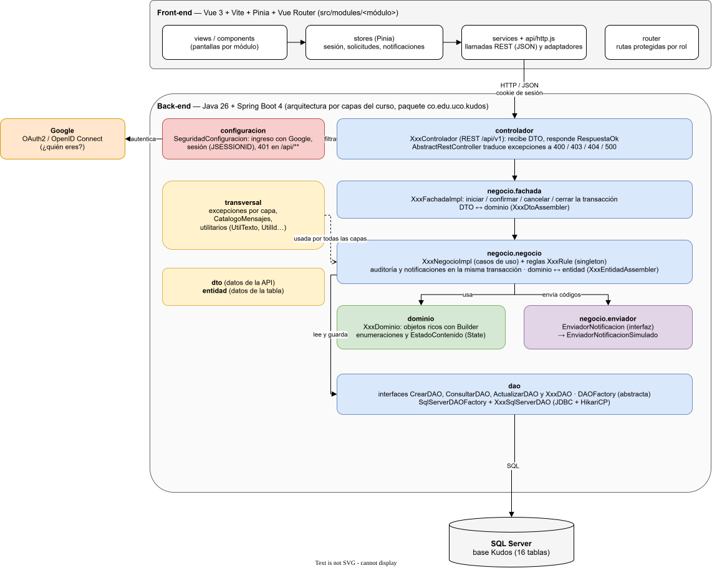
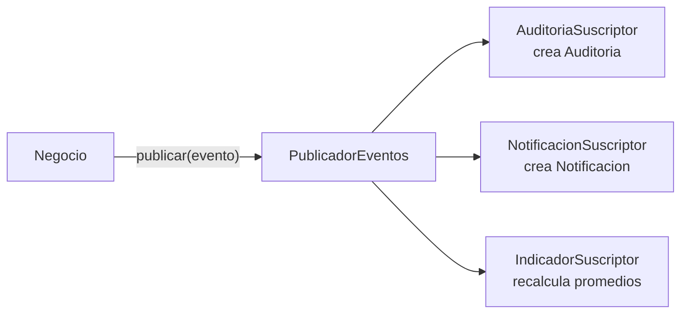

# Arquitectura

[Inicio](../../README.md) · [Patrones utilizados](patrones.md) · [Diagramas de comportamiento](../06-diagramas-comportamiento/README.md) · [Decisiones de diseño](../00-analisis/decisiones-de-diseno.md)

Este documento cubre las secciones 12 (Arquitectura) y 13 (Patrones) del contenido mínimo, junto con [patrones.md](patrones.md). Responde a los requisitos ARQ-001 a ARQ-080 y RNF-031 a RNF-033.

---

## 1. Estilo arquitectónico: capas del curso con dominio enriquecido

La solución usa el **estilo arquitectónico por capas visto en el curso**, el mismo del proyecto de referencia (Sigma — Pizzería UCO): `controlador → fachada → negocio → dao`. Lo acompañan los paquetes `dominio`, `dto`, `entidad`, los ensambladores (*assemblers*) y `transversal` (ARQ-001, D-29).

Hay **una diferencia deliberada** con Sigma. En Sigma los objetos de `dominio` solo tenían Builder y getters, es decir, eran anémicos. Aquí los objetos de dominio **tienen comportamiento**: `kudo.vetar()`, `usuario.intentarActivar()`, `reporte.aceptar()`. El enunciado lo exige (ARQ-008, ARQ-047, ARQ-049: "no se espera una solución basada exclusivamente en getters y setters").

[](../../assets/diagramas/arquitectura-capas.svg)

> También disponible en [PNG](../../assets/diagramas/arquitectura-capas.png). Fuente editable: [`fuentes/arquitectura-capas.drawio`](../../fuentes/arquitectura-capas.drawio).

### ¿Por qué este estilo? (ARQ-002)

| Criterio | Cómo lo cumple |
|---|---|
| Separación de responsabilidades (ARQ-003, ARQ-041) | Cada capa tiene una sola razón para cambiar: HTTP, transacción, reglas, comportamiento del dominio o SQL. |
| Bajo acoplamiento (ARQ-004, ARQ-016) | Cada capa conoce solo a la siguiente y a través de **interfaces**: `KudoFachada`, `KudoNegocio`, `KudoDAO`, `DAOFactory`. |
| Evolución (ARQ-005, ARQ-077) | Cambiar SQL Server por otro motor solo exige otra implementación de `DAOFactory`. Agregar un suscriptor de eventos no toca el negocio. |
| Testabilidad (ARQ-068) | El negocio recibe su `DAOFactory` por constructor, así las pruebas usan una fábrica falsa sin base de datos. |
| Conocido por el equipo y el docente | Es el estilo del curso y de Sigma, así que se puede explicar y modificar en vivo (SUS-009, SUS-011). |

---

## 2. Capas y responsabilidades

| Capa / paquete | Responsabilidad | Qué **no** hace | Depende de |
|---|---|---|---|
| `controlador` | Recibir la petición HTTP, convertir JSON ↔ DTO, devolver la `Respuesta` uniforme. `AbstractRestController` (`@RestControllerAdvice`) traduce las excepciones a códigos HTTP. | No valida reglas de negocio ni abre transacciones. | `negocio.fachada` (interfaces), `dto` |
| `negocio.fachada` | Punto de entrada de cada caso de uso. Crea la `DAOFactory`, **abre, confirma o cancela la transacción** y convierte DTO ↔ dominio con los `DTOAssembler`. Traduce errores inesperados a `KudosFachadaExcepcion`. | No contiene reglas. | `negocio.negocio`, `dto`, `dominio` |
| `negocio.negocio` | Orquesta el caso de uso: ejecuta las **reglas** (`Rule`) que necesitan consultar datos, usa los **servicios de dominio** (`ServicioAprobacion`, `ServicioModeracion`) y las **políticas** (`PoliticaAmbito`…), pide al dominio que actúe, persiste con los DAO y **publica los eventos**. | No conoce HTTP ni SQL. | `dominio`, `dao` (interfaces), `evento` |
| `dominio` | El modelo enriquecido: entidades con comportamiento, objetos de valor, estados (State) y eventos de dominio. Protege sus invariantes. | No conoce Spring, JDBC ni HTTP: es Java puro. | `transversal` |
| `evento` | `PublicadorEventos` y sus suscriptores: auditoría, notificaciones e indicadores (Observer). | — | `dao`, `dominio` |
| `dao` | Interfaces genéricas (`CrearDAO`, `ConsultarDAO`, `ActualizarDAO`…), una interfaz por entidad y la fábrica abstracta `DAOFactory`. Implementación `SqlServerDAOFactory` + `SqlServer*DAO` con JDBC y HikariCP. | No decide reglas. | `entidad`, `transversal` |
| `dto` / `entidad` | Estructuras de datos de la API y de la tabla, con Builder. | — | `transversal` |
| `transversal` | Jerarquía de excepciones por capa, `CatalogoMensajes` y utilitarios (`UtilTexto`, `UtilId`, `UtilFecha`, `UtilObjeto`, `UtilSql`), como en Sigma. | — | — |
| `configuracion` | Spring Security: autenticación, sesión, BCrypt, respuestas 401/403. | — | — |

**Regla de dependencias**: las flechas van siempre hacia abajo. El `dominio` es el centro y no depende de ninguna capa técnica (ARQ-042), así que se puede probar con JUnit puro.

### Paquetes del back-end

```
co.edu.uco.kudos
├── KudosApplication.java
├── configuracion/                 ← SeguridadConfiguracion
├── controlador/                   ← AbstractRestController + respuesta/ (Respuesta, RespuestaOk, RespuestaError)
│   └── impl/                      ← KudoControlador, UsuarioControlador, ModeracionControlador…
├── negocio/
│   ├── fachada/                   ← interfaces XxxFachada
│   │   ├── impl/                  ← XxxFachadaImpl (transacción)
│   │   └── assembler/             ← DTOAssembler + impl/
│   └── negocio/                   ← interfaces XxxNegocio
│       ├── impl/                  ← XxxNegocioImpl
│       ├── assembler/             ← EntidadAssembler + impl/
│       ├── reglas/                ← Rule + impl/<modulo>/ (AsegurarCategoriaActivaRule…)
│       ├── servicio/              ← ServicioAprobacion, ServicioModeracion
│       └── politica/              ← PoliticaAmbito, PoliticaModeracion, PoliticaGestionCategorias
├── dominio/                       ← Usuario, Kudo, Replica… (comportamiento)
│   ├── valor/                     ← CorreoInstitucional, NumeroCelular, ContenidoTexto, Estrellas
│   ├── estado/                    ← EstadoContenido, EstadoCuenta… (State)
│   ├── conversacion/              ← Conversacion, NodoConversacion (Composite)
│   └── evento/                    ← EventoDominio + KudoPublicado, ContenidoVetado…
├── evento/                        ← PublicadorEventos, SuscriptorEvento + suscriptores
├── dto/                           ← KudoDto, UsuarioDto…
├── entidad/                       ← KudoEntidad, UsuarioEntidad…
├── dao/
│   ├── datos/                     ← CrearDAO, ConsultarDAO, ActualizarDAO…
│   │   └── entidad/               ← KudoDAO, UsuarioDAO… + sqlserver/
│   └── factoria/                  ← DAOFactory, FactoriaEnum, impl/SqlServerDAOFactory
└── transversal/                   ← excepciones/, catalogo/CatalogoMensajes, utilitario/
```

---

## 3. Recorrido de una petición

Ejemplo: **crear un Kudo** (CU-001). El [diagrama de secuencia](../06-diagramas-comportamiento/README.md#crear-kudo) lo muestra completo.

1. El front-end envía `POST /api/v1/kudos` con destinatario, categoría y contenido. Spring Security verifica la sesión: sin sesión responde 401.
2. `KudoControlador` recibe el `KudoDto`, obtiene el usuario de la sesión y llama a `KudoFachada.crear(dto, actor)`.
3. `KudoFachadaImpl` crea la `DAOFactory`, **inicia la transacción** y convierte el DTO a dominio.
4. `KudoNegocioImpl` ejecuta las reglas que consultan datos (autor activo, destinatario activo y distinto, categoría activa) y crea el objeto con `Kudo.crear(...)`. El objeto valida su propio contenido con `ContenidoTexto` y se publica: el estado pasa de CREADO a VISIBLE.
5. El negocio convierte el dominio a entidad y lo guarda con `KudoDAO.crear()`. Luego publica el evento `KudoPublicado`.
6. Los suscriptores crean el registro de auditoría y la notificación al destinatario, **en la misma transacción**.
7. La fachada **confirma la transacción**. Si algo falla, la cancela y no queda nada a medias. Al final cierra la conexión.
8. El controlador responde `200` con la `Respuesta` uniforme.

---

## 4. Transacciones

- **La fachada define el límite transaccional** de cada caso de uso, igual que en Sigma: `iniciarTransaccion()`, `confirmarTransaccion()` o `cancelarTransaccion()` y `cerrarConexion()` en el `finally`.
- Una transacción modifica un **agregado**. Cuando un caso de uso toca varios (aprobar una solicitud, vetar un contenido), un **servicio de dominio** los coordina dentro de la misma transacción. Ver la [tabla de agregados](../01-modelo-dominio/README.md#agregados).
- Los suscriptores de eventos (auditoría, notificaciones, indicadores) corren **dentro** de la transacción: si la auditoría falla, la operación se cancela. Así nunca existe una operación sin su registro (RN-096 a RN-100).
- Las consultas no abren transacción; solo abren y cierran la conexión.

## 5. Manejo de errores (RNF-006, ARQ-076)

| Elemento | Descripción |
|---|---|
| `KudosExcepcion` | Clase padre con capa, mensaje para el usuario, mensaje técnico y excepción raíz, igual que `PizzeriaExcepcion` en Sigma. |
| Una excepción por capa | `KudosControladorExcepcion`, `KudosFachadaExcepcion`, `KudosNegocioExcepcion`, `KudosDominioExcepcion`, `KudosDatosExcepcion`, `KudosTransversalExcepcion`. |
| `CatalogoMensajes` | Mensajes para el usuario agrupados por tema. Un buen mensaje dice qué falló, por qué y qué hacer. |
| `AbstractRestController` | Regla de negocio incumplida → **400**. Sin permiso por rol o ámbito → **403**. Recurso inexistente → **404**. Error inesperado → **500** con un mensaje genérico. El detalle técnico va al log (SLF4J), nunca a la respuesta. |
| `Respuesta` | Forma uniforme de todas las respuestas: `correlationId`, `timestamp`, `datos`, `mensajes` y `estado`. El `correlationId` permite ubicar el error en el log. |

## 6. Seguridad (RNF-001 a RNF-004, D-09)

- **Autenticación propia**: correo institucional y contraseña con Spring Security. La contraseña se guarda con hash **BCrypt**. Al autenticarse se verifica además que la cuenta esté `ACTIVA` (`Usuario.puedeIniciarSesion()`, RN-089).
- **Sesión** con cookie `HttpOnly` y `SameSite=Lax`, que expira tras 30 minutos de inactividad. Sin sesión, todo `/api/**` responde 401, salvo registro, verificación e ingreso.
- **Autorización en dos niveles**:
  1. **Por rol**, en la capa de negocio: el rol vigente se carga con el usuario de la sesión.
  2. **Por ámbito**, en el dominio y el negocio, con `PoliticaAmbito`: un Coordinador de Programa solo actúa sobre su programa, por ejemplo (POL-004, RN-112 a RN-131).
- La autorización **no** se confía al front-end: el front oculta opciones por comodidad, pero el back-end vuelve a validar todo.
- Las credenciales de la base de datos van en `basedatos.properties`, fuera del control de versiones, como en Sigma.
- El front-end corre en `localhost:5173` y llama al back-end mediante el *proxy* de Vite, así que no hace falta abrir CORS.

## 7. Eventos de dominio y auditoría (D-26)



Cada operación relevante produce un **evento de dominio** (`KudoPublicado`, `UsuarioAprobado`, `ContenidoVetado`…). El catálogo completo está en el [modelo de dominio](../01-modelo-dominio/README.md#catálogo-de-eventos-de-dominio). El negocio **no sabe** que existen la auditoría ni las notificaciones: solo publica. Agregar un nuevo efecto, como enviar un correo real, es agregar un suscriptor sin modificar el negocio (OCP). Es el patrón **Observer** ([patrones](patrones.md#3-observer)).

## 8. Persistencia (D-30, ARQ-062 a ARQ-064)

- **JDBC + HikariCP sobre SQL Server**, sin JPA, como en Sigma. Cada `SqlServer*DAO` escribe su SQL con `PreparedStatement`, lo que evita la inyección SQL.
- `DAOFactory` es una **fábrica abstracta**: da todos los DAO que comparten la misma conexión, y por tanto la misma transacción.
- La base de datos **refuerza** las reglas críticas (unicidad, índices únicos filtrados, chequeos y llaves foráneas). Si una regla se escapara del dominio, la base la rechaza ([validación de las restricciones](../03-modelo-entidad-relacion/README.md#validación-de-las-restricciones)).
- No hay borrado físico (D-28): los DAO de negocio no tienen operación `eliminar`.
- Los listados grandes (muro, conversación, auditoría, reportes) son paginados (RNF-010).

---

## 9. API REST

Base: `/api/v1`. Todas las respuestas usan la `Respuesta` uniforme. "Público" significa sin sesión.

| Recurso | Método y ruta | Caso de uso | Quién |
|---|---|---|---|
| **Autenticación** | `POST /autenticacion/ingreso` | CU-018 | Público |
| | `POST /autenticacion/salir` | CU-019 | Usuario activo |
| | `GET /autenticacion/usuario-actual` | — | Usuario activo |
| **Registro y verificación** | `POST /registros` | CU-016 | Público |
| | `POST /verificaciones/correo` · `POST /verificaciones/celular` | CU-017 | Público |
| | `POST /verificaciones/{canal}/reenvio` | CU-017 | Público |
| **Mi cuenta** | `GET /usuarios/yo` | CU-020 | Usuario activo |
| | `PUT /usuarios/yo/datos-personales` · `PUT /usuarios/yo/correo` · `PUT /usuarios/yo/celular` | CU-020 | Usuario activo |
| | `GET /usuarios/yo/actividad` | CU-021 | Usuario activo |
| **Usuarios** | `GET /usuarios` (filtros) · `GET /usuarios/{id}` | CU-034 | Autoridad (según ámbito) |
| | `POST /usuarios/rectores` · `POST /usuarios/administradores` | CU-024, CU-025 | Administrador |
| | `POST /usuarios/{id}/suspension` · `/reactivacion` · `/desactivacion` | CU-026, CU-027 | Autoridad que gestiona |
| **Solicitudes** | `GET /solicitudes/pendientes` | CU-022 | Autoridad |
| | `POST /solicitudes/{id}/aprobacion` · `POST /solicitudes/{id}/rechazo` | CU-022, CU-023 | Autoridad |
| **Estructura** | `GET /facultades` · `POST /facultades` · `PUT /facultades/{id}` · `POST /facultades/{id}/inactivacion` | CU-028, CU-029, CU-034 | Coord. Académico (consulta: todos) |
| | `GET /facultades/{id}/coordinadores` | CU-034 | Coord. Académico, Coord. de esa Facultad |
| | `GET /programas` · `POST /programas` · `PUT /programas/{id}` · `POST /programas/{id}/inactivacion` | CU-030, CU-031, CU-034 | Coord. Académico (consulta: todos) |
| | `GET /programas/{id}/coordinadores` · `GET /programas/{id}/vinculos` | CU-034 | Coordinadores (según ámbito) |
| | `POST /programas/{id}/vinculos` · `POST /vinculos/{id}/desvinculacion` | CU-032, CU-033 | Coord. de Programa |
| | `GET /usuarios/{id}/vinculos` · `GET /cargos/vigentes` | CU-034 | Usuario activo |
| **Categorías** | `GET /categorias` · `POST /categorias` · `PUT /categorias/{id}` · `POST /categorias/{id}/activacion` · `/desactivacion` | CU-035 | Gestor de categorías (consulta: todos) |
| **Kudos** | `GET /kudos?categoria=&persona=&pagina=` (muro) | CU-042 | Usuario activo |
| | `POST /kudos` · `GET /kudos/{id}` | CU-001, CU-002 | Usuario activo |
| | `GET /usuarios/{id}/kudos?tipo=recibidos\|emitidos` | CU-003 | Usuario activo |
| **Conversación** | `GET /kudos/{id}/conversacion` | CU-006 | Usuario activo |
| | `POST /kudos/{id}/replicas` · `POST /replicas/{id}/respuestas` | CU-004, CU-005 | Usuario activo |
| **Calificaciones** | `PUT /kudos/{id}/calificacion` · `PUT /replicas/{id}/calificacion` (crea o modifica) | CU-007, CU-008 | Usuario activo |
| | `GET /kudos/{id}/valoraciones` · `GET /replicas/{id}/valoraciones` | CU-009 | Usuario activo |
| **Reportes** | `POST /kudos/{id}/reportes` · `POST /replicas/{id}/reportes` | CU-010, CU-011 | Usuario activo |
| | `GET /reportes` | CU-012 | Moderador (los demás: solo los propios) |
| **Moderación** | `POST /moderaciones` (iniciar revisión) | CU-036 | Moderador |
| | `POST /moderaciones/veto` · `POST /moderaciones/{id}/liberacion` | CU-013, CU-014, CU-037 | Moderador |
| | `GET /moderaciones/vetos` | CU-015 | Moderador |
| **Otros** | `GET /auditoria` | CU-038 | Autoridad (según ámbito) |
| | `GET /notificaciones` · `POST /notificaciones/{id}/lectura` | CU-039 | Usuario activo |
| | `GET /indicadores` | CU-040 | Usuario activo |
| | `GET /parametros` · `PUT /parametros/{id}` | CU-041 | Administrador |

Cada recurso tiene su controlador, su fachada y su negocio: `KudoControlador` → `KudoFachada` → `KudoNegocio`, y así sucesivamente. Las peticiones de ejemplo se entregan como colección de **Bruno**, igual que en Sigma.

---

## 10. Front-end (Vue 3)

Misma organización del front-end de Sigma (`pizzeria-frontend`): un módulo por área del negocio y componentes de interfaz reutilizables.

```
kudos-frontend/src
├── api/                 ← http.js (fetch con cookie de sesión, manejo uniforme de Respuesta y errores), config.js
├── components/
│   ├── layout/          ← AppSidebar (menú según rol), AppTopbar (notificaciones), MainLayout
│   └── ui/              ← BaseButton, BaseModal, BaseTable, BasePagination, StatusBadge, ConfirmDialog…
├── modules/
│   ├── autenticacion/   ← LoginView, RegistroView, VerificacionView
│   ├── muro/            ← MuroView, KudoDetalleView, CrearKudoModal, KudoCard ("Ver más"),
│   │                       ConversacionArbol (recursivo), CalificacionEstrellas, ReportarModal
│   ├── perfil/          ← PerfilView, MiActividadView, HistorialKudosView
│   ├── organizacion/    ← FacultadesView, ProgramasView, ProgramaDetalleView, EstructuraView
│   ├── aprobaciones/    ← SolicitudesView, GestionUsuariosView
│   ├── categorias/      ← CategoriasView
│   ├── moderacion/      ← ReportesView, HistoricoVetosView
│   ├── administracion/  ← ParametrosView, AuditoriaView
│   ├── notificaciones/  ← NotificacionesView
│   └── indicadores/     ← IndicadoresView
│   (cada módulo con views/, components/, services/, stores/ y __tests__/)
├── router/              ← rutas y guardas: requiere sesión y rol permitido
└── stores/              ← sesionStore (usuario actual y rol)
```

| Requisito de interfaz | Cómo se cumple |
|---|---|
| Comprender el estado del sistema (ARQ-065, RNF-036) | Insignias de estado (`StatusBadge`) en cuentas, contenidos, reportes y solicitudes. Mensajes claros de éxito y error. |
| Navegar conversaciones (ARQ-066, RNF-037) | `ConversacionArbol` es un componente **recursivo** que dibuja el árbol con sangría por nivel, contraer y expandir, y un botón "responder" en cada nodo. |
| Kudos extensos (ARQ-067, RNF-038) | `KudoCard` recorta el texto **solo visualmente** y ofrece "Ver más". El detalle muestra el contenido completo. |
| Menú según rol | `AppSidebar` muestra las opciones del rol vigente; el back-end vuelve a validar cada operación. |
| Pruebas (RNF-023) | Vitest para stores, servicios y validaciones, como en Sigma. |

---

## 11. Principios de diseño aplicados

### SOLID (RNF-019, ARQ-022 a ARQ-030)

| Principio | Dónde se ve |
|---|---|
| **S** — Responsabilidad única | Cada capa tiene una razón de cambio. Cada regla es una clase (`AsegurarCategoriaActivaRule`). `ContenidoTexto` solo sabe validar contenido. `PublicadorEventos` solo reparte eventos y cada suscriptor hace una sola cosa. |
| **O** — Abierto/cerrado | Un nuevo efecto de un evento es un nuevo suscriptor. Un nuevo estado de contenido se agrega en `EstadoContenido` sin tocar `Kudo`. Un nuevo motor de base de datos es una nueva `DAOFactory`. |
| **L** — Sustitución de Liskov | `Kudo` y `Replica` cumplen el contrato de `ContenidoConversable`: cualquiera se puede calificar, reportar o moderar con el mismo código. `SqlServerDAOFactory` y una fábrica de pruebas son intercambiables. |
| **I** — Segregación de interfaces | Los DAO combinan interfaces pequeñas (`CrearDAO`, `ConsultarDAO`, `ActualizarDAO`) según lo que necesita cada entidad. `AuditoriaDAO` no tiene `actualizar`, porque la auditoría es inmutable. |
| **D** — Inversión de dependencias | El negocio depende de `DAOFactory`, `KudoDAO`, `EnviadorNotificacion` y `PublicadorEventos` (abstracciones), no de JDBC ni de un proveedor de correo. |

### Otros principios (ARQ-031 a ARQ-057)

| Principio | Aplicación |
|---|---|
| **Tell, Don't Ask** (ARQ-043) | Se le dice al objeto qué hacer (`kudo.vetar()`) en vez de preguntarle su estado y decidir afuera (`if (kudo.getEstado() != VETADO) kudo.setEstado(VETADO)`). |
| **Ley de Demeter** (ARQ-045) | El negocio habla con sus colaboradores directos. Por ejemplo, `kudo.admiteInteraccion()` en lugar de `kudo.getEstado().esFinal()`. |
| **Composición sobre herencia** (ARQ-014, ARQ-015) | Los roles son `AsignacionRol` (composición), no subclases de `Usuario`. Ver la [justificación](../01-modelo-dominio/README.md#por-qué-rector-docente-estudiante-no-son-clases). |
| **DRY** (ARQ-037) | La autoría de las operaciones vive en la auditoría y no se repite en cada entidad (D-31). Las validaciones de formato viven en los objetos de valor. |
| **KISS** (ARQ-039) | La exclusividad de roles se garantiza con **un solo** rol vigente, no con 30 validaciones. Se evitan patrones sin un problema concreto ([patrones descartados](patrones.md#patrones-evaluados-y-descartados)). |
| **Lenguaje del dominio** (ARQ-055 a ARQ-057) | Clases y métodos con los nombres del negocio, en español: `Kudo`, `Replica`, `vetar`, `aprobar`, `vincular`. |
| **Clean Code** (ARQ-031 a ARQ-036) | Nombres expresivos, métodos cortos, sin comentarios que compensen código confuso, constantes con nombre y mensajes en `CatalogoMensajes`. |

---

## 12. Resumen de decisiones arquitectónicas

| Decisión | Alternativa descartada | Motivo | Referencia |
|---|---|---|---|
| Capas del curso con dominio enriquecido | Dominio anémico como Sigma | El enunciado exige objetos ricos | D-29 |
| JDBC + HikariCP | JPA/Hibernate | Estilo del curso; control explícito del SQL y de la transacción | D-30 |
| Transacción en la fachada | Transacción en el controlador o en cada DAO | Un caso de uso es una unidad de trabajo | §4 |
| Login propio con BCrypt y sesión | Google OAuth (como Sigma) | Hay que verificar correo **y** celular con códigos propios | D-09 |
| Eventos de dominio + suscriptores | Llamar a la auditoría desde cada caso de uso | Desacopla el negocio de la auditoría y las notificaciones (OCP) | D-26 |
| Envío de códigos simulado detrás de una interfaz | Integrar un proveedor real de SMS o correo | Fuera del alcance; se cambia sin tocar el dominio | D-10 |
| Reglas reforzadas en la base de datos | Validar solo en Java | Defensa en profundidad e integridad ante concurrencia | D-14, RNF-040 |
