# Diagramas de comportamiento

[Inicio](../../README.md) · [Arquitectura](../05-arquitectura/README.md) · [Casos de uso](../04-diagrama-casos-uso/README.md) · [Modelo de dominio](../01-modelo-dominio/README.md)

Diagramas UML que muestran **cómo se comporta** el sistema: los ciclos de vida de los objetos (UML-005 estado), los procesos de negocio (UML-004 actividad) y la colaboración entre capas y objetos en los casos de uso principales (UML-003 secuencia).

> Fuentes editables en draw.io: [`diagramas-estado.drawio`](../../fuentes/diagramas-estado.drawio), [`diagramas-actividad.drawio`](../../fuentes/diagramas-actividad.drawio) y [`diagramas-secuencia.drawio`](../../fuentes/diagramas-secuencia.drawio), con una página por diagrama.

## Contenido

- **Diagramas de estado**: Estado de Kudo y Réplica, Estado de la cuenta, Estado del reporte, Estado de la solicitud de registro, Estado de la Facultad, Estado de la moderación
- **Diagramas de actividad**: Registro y activación de una cuenta, Moderación de contenido, Publicar un Kudo y conversar
- **Diagramas de secuencia**: Crear Kudo, Aprobar solicitud de registro, Vetar contenido, Verificar celular y activar la cuenta, Ingresar con Google

## 1. Diagramas de estado (UML-005)

### Estado de Kudo y Réplica

Ciclo de vida del contenido (RN-201 a RN-209, D-20). Se implementa con el patrón State: la enumeración EstadoContenido decide cada transición y KudoDominio / ReplicaDominio solo delegan. Un reporte que llega durante la revisión no cambia el estado.

> También disponible en [PNG](../../assets/diagramas/diagramas-estado-1.png).

Versión en texto del diagrama (Mermaid)

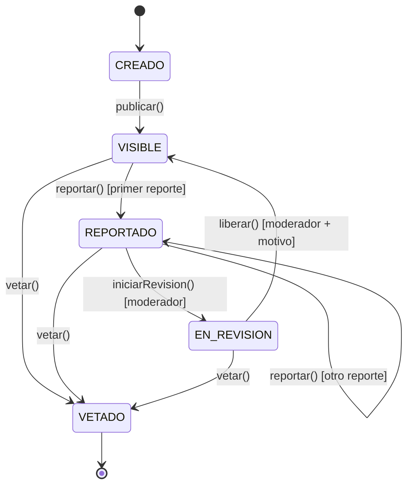

### Estado de la cuenta

Ciclo de vida de la cuenta (RN-084 a RN-089, RN-216, RN-217, D-07, D-17), métodos de UsuarioDominio. El autorregistro nace en PENDIENTE_APROBACION; el Rector y los Administradores que registra un Administrador nacen ya aprobados en PENDIENTE_VERIFICACION. La suspensión y la reactivación las hace automáticamente la desvinculación y la nueva vinculación; desactivar existe en el dominio, pero su pantalla queda fuera del alcance.

> También disponible en [PNG](../../assets/diagramas/diagramas-estado-2.png).

Versión en texto del diagrama (Mermaid)

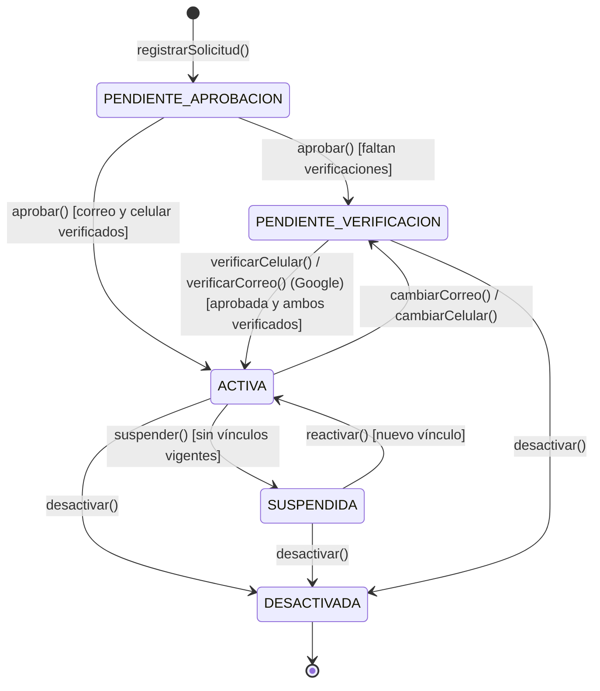

### Estado del reporte

Ciclo de vida del reporte (RN-210 a RN-212, D-24), métodos de ReporteDominio. Si el contenido ya está en revisión, el reporte nace directamente EN_REVISION.

> También disponible en [PNG](../../assets/diagramas/diagramas-estado-3.png).

Versión en texto del diagrama (Mermaid)

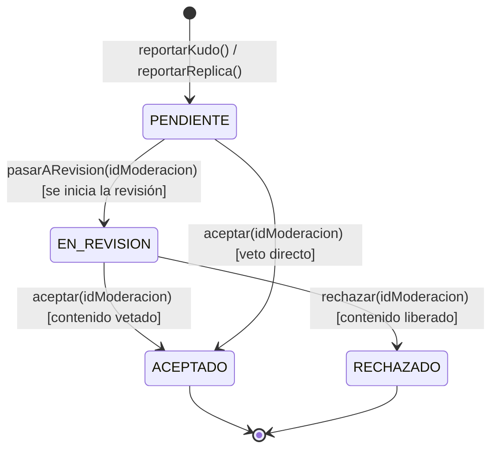

### Estado de la solicitud de registro

Ciclo de vida de la solicitud (RN-090 a RN-093, RN-108, D-17).

> También disponible en [PNG](../../assets/diagramas/diagramas-estado-4.png).

Versión en texto del diagrama (Mermaid)

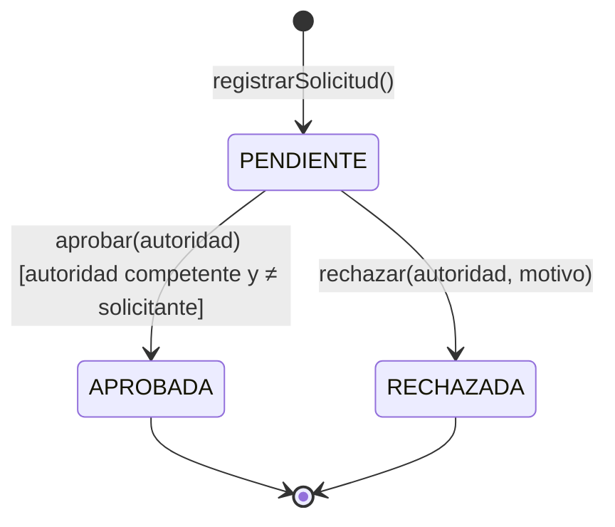

### Estado de la Facultad

Ciclo de vida de la Facultad (RN-045, D-05).

> También disponible en [PNG](../../assets/diagramas/diagramas-estado-5.png).

Versión en texto del diagrama (Mermaid)

### Estado de la moderación

Ciclo de vida de la moderación (RN-239, RN-240, RN-250), métodos de ModeracionDominio. ModeracionNegocioImpl la crea al iniciar la revisión; en un veto directo la crea y la cierra en el mismo paso.

> También disponible en [PNG](../../assets/diagramas/diagramas-estado-6.png).

Versión en texto del diagrama (Mermaid)

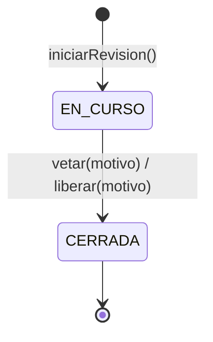

## 2. Diagramas de actividad (UML-004)

### Registro y activación de una cuenta

Desde que la persona ingresa con Google por primera vez hasta que puede usar la aplicación (CU-016, CU-017, CU-018, CU-022, RN-084 a RN-093).

> También disponible en [PNG](../../assets/diagramas/diagramas-actividad-1.png).

Versión en texto del diagrama (Mermaid)

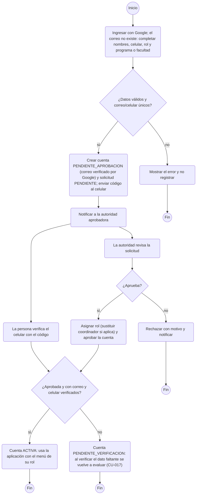

### Moderación de contenido

Desde el reporte de un contenido hasta la decisión del moderador (CU-010 a CU-014, CU-036, CU-037).

> También disponible en [PNG](../../assets/diagramas/diagramas-actividad-2.png).

Versión en texto del diagrama (Mermaid)

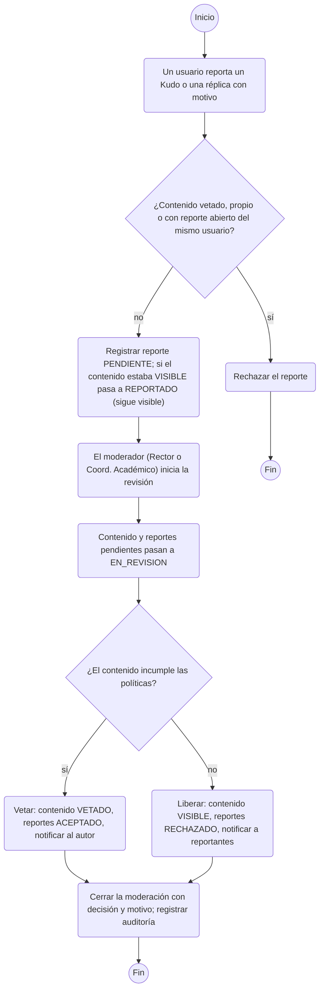

### Publicar un Kudo y conversar

Creación de un Kudo, réplicas y calificaciones (CU-001, CU-004, CU-005, CU-007).

> También disponible en [PNG](../../assets/diagramas/diagramas-actividad-3.png).

Versión en texto del diagrama (Mermaid)

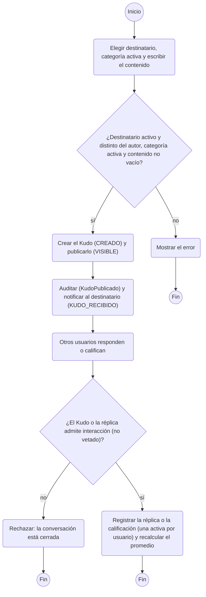

## 3. Diagramas de secuencia (UML-003)

### Crear Kudo

CU-001. Recorrido real por las capas: controlador, fachada (transacción), negocio, reglas, dominio (patrón State), DAO, notificación y auditoría en la misma transacción.

> También disponible en [PNG](../../assets/diagramas/diagramas-secuencia-1.png).

Versión en texto del diagrama (Mermaid)

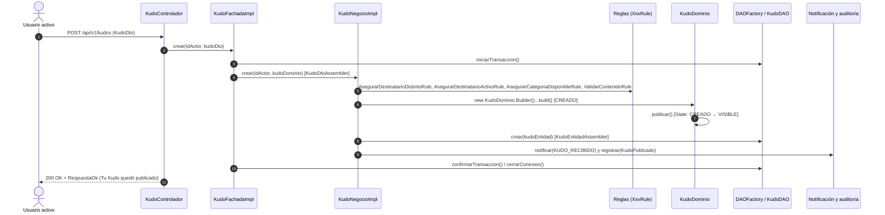

### Aprobar solicitud de registro

CU-022. SolicitudNegocioImpl coordina varios objetos en una sola transacción, incluida la sustitución de un coordinador.

> También disponible en [PNG](../../assets/diagramas/diagramas-secuencia-2.png).

Versión en texto del diagrama (Mermaid)

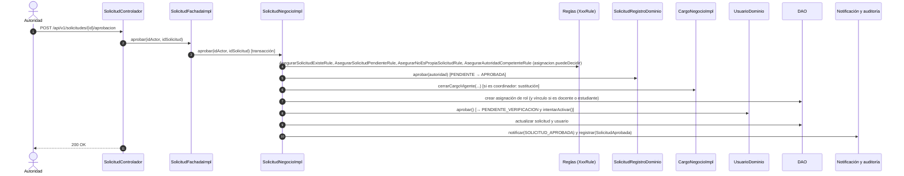

### Vetar contenido

CU-013 / CU-014. La decisión cambia la moderación, el contenido y sus reportes en una transacción; si no había revisión en curso es un veto directo.

> También disponible en [PNG](../../assets/diagramas/diagramas-secuencia-3.png).

Versión en texto del diagrama (Mermaid)

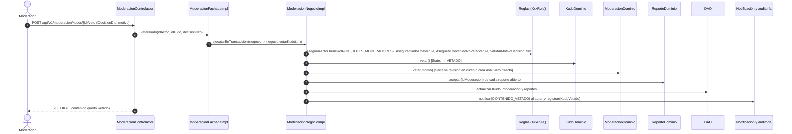

### Verificar celular y activar la cuenta

CU-017. El código lo valida AsegurarCodigoVigenteRule y la activación la decide UsuarioDominio.

> También disponible en [PNG](../../assets/diagramas/diagramas-secuencia-4.png).

Versión en texto del diagrama (Mermaid)

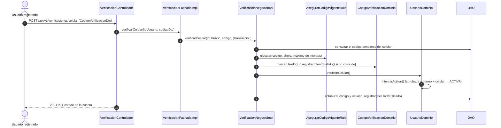

### Ingresar con Google

CU-018 y D-09. Google autentica a la persona; la aplicación decide con su propia base de datos qué puede hacer.

[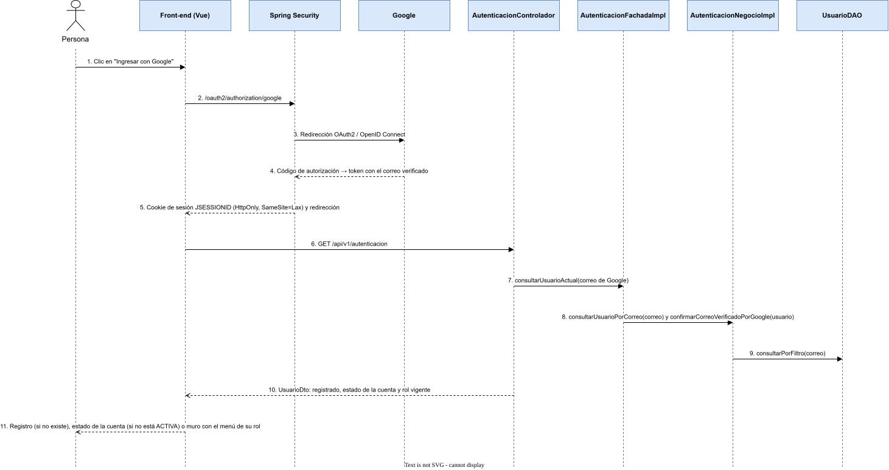](../../assets/diagramas/diagramas-secuencia-5.svg)

> También disponible en [PNG](../../assets/diagramas/diagramas-secuencia-5.png).

Versión en texto del diagrama (Mermaid)

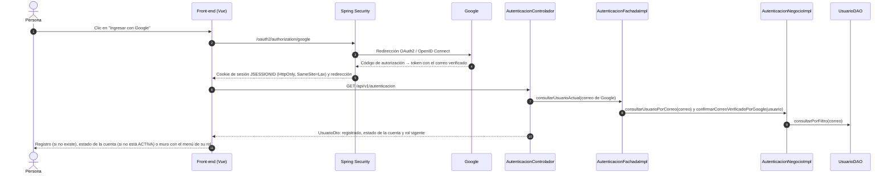

## Cómo se relacionan con el resto del diseño

- Cada **estado** corresponde a una enumeración del [modelo de dominio](../01-modelo-dominio/README.md#enumeraciones) y cada transición es un método de negocio de la clase (por ejemplo `vetar()` en [Kudo](../02-diagrama-clases/clases/Kudo.md)). El ciclo del contenido se implementa con el patrón **State** ([patrones](../05-arquitectura/patrones.md)).
- Cada **actividad** recorre varios casos de uso de la [especificación](../00-analisis/casos-de-uso.md) y muestra dónde se aplican las políticas.
- Cada **secuencia** sigue las capas de la [arquitectura](../05-arquitectura/README.md): controlador → fachada (transacción) → negocio (`XxxNegocioImpl` y sus reglas `XxxRule`) → dominio (`XxxDominio`) → DAO. Los nombres de los participantes son las clases reales del código. La notificación y la auditoría las registra el negocio dentro de la misma transacción (D-26).

