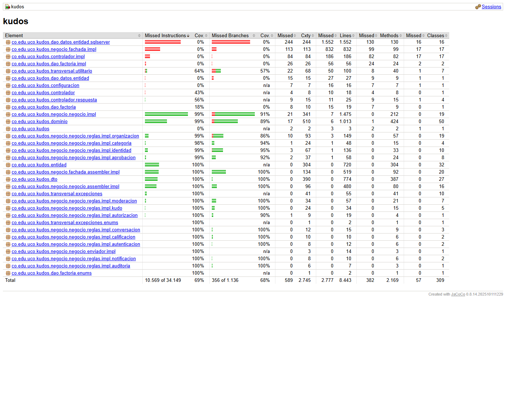

# Calidad del software, análisis estático y pruebas

[Inicio](../../README.md) · [Arquitectura](../05-arquitectura/README.md) · [Matriz de trazabilidad](../00-analisis/matriz-trazabilidad.md)

Cubre las secciones 14 (Calidad del software), 15 (Análisis estático) y 16 (Pruebas) del contenido mínimo, los requisitos RNF-018 a RNF-027, ARQ-068 a ARQ-073 y CAL-001 a CAL-007, y las **evidencias de calidad** del documento 09 §13 (refactorización, análisis estático, revisión de código y principios de diseño). Las evidencias están en la carpeta [`evidencias/`](evidencias/).

**Resumen:** 240 pruebas JUnit y 112 pruebas Vitest, todas exitosas · 99,7 % de líneas cubiertas en el código que mide Sonar · 0 vulnerabilidades y 0 *code smells* en SonarQube Cloud · ESLint y oxlint sin errores · 16 violaciones de reglas rechazadas por la base de datos · 84 peticiones de API en Bruno.

---

## 1. Atributos de calidad y cómo se aseguran

| Atributo (CAL) | Cómo se asegura en el diseño | Cómo se verifica |
|---|---|---|
| Legibilidad (CAL-001) | Lenguaje del dominio en español, métodos cortos, Builder, mensajes en `CatalogoMensajes`, sin comentarios que compensen código confuso | SonarQube (*code smells*: 0), revisión de código (§7) |
| Mantenibilidad (CAL-002) | Capas con dependencias en un solo sentido; una regla por clase; patrón State; transacción en un solo lugar | SonarQube: mantenibilidad **A**, duplicación controlada (§4) |
| Reutilización (CAL-003) | `AsegurarActorTieneRolRule` para todos los módulos, DAO genéricos, `UtilTexto`, componentes `Base*` en Vue, `src/api/consultas.js` | Revisión de código |
| Acoplamiento (CAL-004) | Interfaces entre capas (`XxxFachada`, `XxxNegocio`, `XxxDAO`, `DAOFactory`, `EnviadorNotificacion`) | Revisión de dependencias entre paquetes |
| Cohesión (CAL-005) | Cada objeto de dominio protege sus reglas (modelo enriquecido); cada negocio, un módulo | Revisión del modelo contra el código ([correspondencia](../01-modelo-dominio/README.md#correspondencia-con-el-código)) |
| Testabilidad (CAL-006) | Dominio en Java puro; negocio con `DAOFactory` inyectada (`DAOFactoryFalsa` en las pruebas) | Cobertura con JaCoCo (§6) |
| Evolución (CAL-007) | OCP en estados, reglas, fábrica de DAO y enviador de códigos | Ejercicios de cambio en la sustentación |

---

## 2. Estrategia de pruebas (ARQ-069)

La estrategia sigue una **pirámide**: muchas pruebas rápidas de dominio y negocio (sin base de datos) y pocas de punta a punta. **Las reglas viven en el dominio y en las reglas de negocio** (modelo enriquecido), así que ahí está el mayor valor y el menor costo de prueba (ARQ-070).

| Nivel | Qué prueba | Herramienta | Base de datos | Ejemplos reales |
|---|---|---|---|---|
| **Unitarias de dominio** (PU) | Transiciones de estado (State), invariantes y decisiones de cada objeto | JUnit 5 | No | `KudoDominioTest` (VETADO no admite interacción, transiciones inválidas), `UsuarioDominioTest` (intentarActivar con sus tres condiciones), `ModeracionDominioTest`, `OrganizacionDominioTest` (puedeDecidir por ámbito) |
| **Reglas y negocio** (PF) | Cada caso de uso con sus reglas, auditoría y notificaciones | JUnit 5 + `DAOFactoryFalsa` (DAO en memoria) | No | `SolicitudNegocioTest` (sustitución de coordinador, Rector duplicado), `ModeracionNegocioTest` (veto directo, liberar avisa una vez a cada reportante), `AuditoriaNegocioTest` (ámbito por rol) |
| **Ensambladores y DTO** | Conversión dominio ↔ entidad ↔ DTO, ocultar contenido vetado, árbol de réplicas | JUnit 5 | No | `AssemblersConversacionTest`, `AssemblersModeracionTest` |
| **Base de datos** | Restricciones de integridad | `sql/validar_sql.py` + SQL Server | Sí (temporal) | 16 violaciones de reglas rechazadas (§5) |
| **Verificación con la base real** | Cada módulo de punta a punta contra la base `Kudos`, con **rollback** al final | Negocio real + SQL Server | Sí (sin dejar cambios) | Árbol de réplicas de 9 niveles, Kudo de 22 000 caracteres sin recorte, veto directo con aviso recortado a 500 caracteres, auditoría por ámbito |
| **API** (PA) | Endpoints con sesión real | Colección **Bruno** (como en Sigma) | Sí | 84 peticiones en 16 carpetas; las 64 rutas responden 401 sin sesión |
| **Front-end** (PV) | Pantallas, servicios, adaptadores y validaciones | Vitest + Vue Test Utils + servidor falso que imita la API | No | Menú y rutas por rol, reportar y vetar, campana de notificaciones, conversación recursiva |

**Criterio de suficiencia** (RNF-024): **≥ 80 % de cobertura** de líneas, medida con JaCoCo, y al menos una prueba por cada regla de negocio con mensaje de rechazo. Resultado: **99,7 %** (§6). La [matriz de trazabilidad](../00-analisis/matriz-trazabilidad.md) relaciona cada requisito con su prueba.

---

## 3. Análisis estático (RNF-025 a RNF-027, ARQ-071 a ARQ-073)

| Repositorio | Herramientas | Qué se revisa | Cuándo |
|---|---|---|---|
| Back-end | **SonarQube Cloud** + **JaCoCo** (proyecto `JaiderSoto07_kudos-backend`) | *Bugs*, vulnerabilidades, *code smells*, duplicación, *security hotspots* y cobertura | En cada `push`: GitHub Actions ejecuta `./mvnw verify` con JaCoCo y envía el análisis a Sonar |
| Front-end | **ESLint** + **oxlint**, la configuración de Sigma | Errores, malas prácticas y estilo en Vue y JavaScript | `npm run lint` antes de cada entrega de módulo |

**Quality Gate** (condiciones sobre el código nuevo): fiabilidad A, seguridad A, mantenibilidad A, cobertura ≥ 80 %, duplicación ≤ 3 % y 100 % de *security hotspots* revisados.

### Resultados

| Fecha | Repositorio | Herramienta | Bugs | Vulnerabilidades | Code smells | Hotspots revisados | Cobertura | Evidencia |
|---|---|---|---|---|---|---|---|---|
| 10-nov-2026 | Back-end | SonarQube Cloud | 1 (corregido, §4 hallazgo 12) | 0 | 0 | 100 % | 98,7 % (código nuevo: 98,4 %) | [sonarcloud.io](https://sonarcloud.io/project/overview?id=JaiderSoto07_kudos-backend) · `evidencias/sonar-resumen.png` |
| 10-nov-2026 | Back-end | JaCoCo | — | — | — | — | 99,7 % de líneas y 93,1 % de ramas en el código medido | [`evidencias/jacoco-cobertura.png`](evidencias/jacoco-cobertura.png) |
| 10-nov-2026 | Front-end | ESLint + oxlint | 0 errores | — | 0 advertencias | — | — | [`evidencias/lint-front.txt`](evidencias/lint-front.txt) |

> El último análisis de Sonar del 10 de noviembre marcó un *bug* (hallazgo 12) y una duplicación de 3,1 % en el código nuevo (hallazgo 13). Los dos están corregidos en el código entregado; el análisis que corre con el último `push` confirma el Quality Gate en verde (captura `evidencias/sonar-resumen.png`).

### Exclusiones y su justificación

| Configuración (`pom.xml`) | Qué excluye | Por qué |
|---|---|---|
| `sonar.coverage.exclusions` | `dao`, `controlador`, `configuracion`, `negocio/fachada/impl`, `KudosApplication`, `UtilSql` | Son código de infraestructura que solo se puede probar con base de datos, servidor web o Google reales (SQL, HTTP, Spring Security, transacciones). Su comportamiento se verificó con la base real (con rollback), con Bruno y con las pruebas del front. Las **reglas** están todas en código medido. |
| `sonar.cpd.exclusions` | `CatalogoMensajes` y el paquete `entidad` | `CatalogoMensajes` repite la forma de los mensajes por diseño. Las clases `XxxEntidad` son el reflejo de las tablas y repiten, por la arquitectura del curso, los mismos atributos y Builder de su `XxxDominio`; no es lógica duplicada. La duplicación sigue midiéndose en todo lo demás. |

---

## 4. Hallazgos, correcciones y refactorizaciones (RNF-027)

Evidencia de **refactorización**, **análisis estático** y **revisión de código** (doc. 09 §13). Cada hallazgo se corrigió y se volvió a verificar.

| # | Origen | Hallazgo | Causa | Corrección | Antes / después |
|---|---|---|---|---|---|
| 1 | Validación SQL | Los índices únicos filtrados no se creaban | `sqlcmd` trae `QUOTED_IDENTIFIER` apagado | Los scripts activan `set quoted_identifier on` | Antes: el script se detenía en `asignacion_rol`. Después: crea las 16 tablas |
| 2 | Validación SQL | Se aceptaba un reporte con motivo OTRO sin descripción | Un `check` con resultado *desconocido* (comparación con `NULL`) se deja pasar | `ck_reporte_descripcion` exige `descripcion is not null` | Antes: aceptado. Después: rechazado |
| 3 | Validación SQL | Se aceptaba una moderación cerrada sin motivo | La misma causa del hallazgo 2 | `ck_moderacion_cierre` exige `motivo_decision is not null` | Antes: aceptada. Después: rechazada |
| 4 | Revisión del modelo | `Usuario` quedaba conectado con unas 20 relaciones de autoría (`creadaPor`, `modificadoPor`…) | La autoría se repetía en cada entidad | La autoría vive en la auditoría (D-31) | Antes: 36 relaciones. Después: 29 |
| 5 | Revisión de los diagramas | Más de 10 cruces de líneas en los diagramas de dominio, clases y MER | Distribución automática | Distribución optimizada: 1 cruce, el mínimo posible | Ver el [modelo de dominio](../01-modelo-dominio/README.md#diagrama-línea-de-vida) |
| 6 | SonarQube | "Acceso que lanzará `ArrayIndexOutOfBoundsException`" (2 veces) | `obtenerInstancia()` devolvía `Rule<Object>`: Sonar no sabía qué regla se ejecutaba y supuso que una regla de dos datos recibía uno | `obtenerInstancia()` devuelve el **tipo concreto** de cada regla | Antes: 2 *bugs*. Después: 0 |
| 7 | SonarQube | "Acceso que lanzará `NullPointerException`" en `UtilTexto` | Sonar se perdía entre varios métodos y suponía un `null` imposible | `isEmpty()` sobre la variable local | Antes: 1 *bug*. Después: 0 |
| 8 | SonarQube | Duplicación 4,4 % (máximo 3 %) | `CatalogoMensajes` (mensajes parecidos por diseño) y bloques `if` repetidos en 3 DAO | Excluir el catálogo de la medición; **refactorización** `SqlDAO.agregarCondicionId(...)` y `asignarDatosUsuario(...)` | Antes: 4,4 %. Después: bajo el umbral |
| 9 | SonarQube | *Security hotspot* en `csrf.disable()` | Sonar lo marca para revisión humana | Revisado como **Safe**: la API solo recibe JSON, no habilita CORS y la cookie es `SameSite=Lax` (igual que Sigma) | 100 % de *hotspots* revisados |
| 10 | Revisión de código | Cada módulo repetía la validación de permisos | Se escribía la consulta de roles en cada negocio | **Refactorización**: una sola regla `AsegurarActorTieneRolRule(idActor, roles, mensaje)` y la excepción `KudosAutorizacionExcepcion` (403) | Antes: 400 sin permiso. Después: 403 y una sola regla |
| 11 | SonarQube | "Acceso que lanzará `NullPointerException`" en `AsegurarDestinatarioDistintoRule` | `idDestinatario.equals(...)`: Sonar no ve que `UtilId.esValorDefecto(null)` ya lanzó la excepción | La regla pasa a `Rule<UUID>` (sin conversiones) y compara con `Objects.equals`; mismo cambio preventivo en `AsegurarContenidoAjenoRule` | Antes: 1 *bug*. Después: 0 |
| 12 | SonarQube | "Acceso que lanzará `NullPointerException`" en `ReplicaNegocioImpl.notificar` | El mismo caso del hallazgo 11 | `Objects.equals(destinatario.getId(), idActor)`; se quitó una condición que nunca podía darse | Antes: 1 *bug*. Después: 0 |
| 13 | SonarQube | Duplicación 3,1 % en el código nuevo (máximo 3 %) | Pares `XxxDominio` / `XxxEntidad` con los mismos atributos por diseño | Excluir el paquete `entidad` de la detección de duplicados (justificación en §3) | Antes: 3,1 %. Después: bajo el umbral |
| 14 | SonarLint (front) | "Promises must be awaited" en `MuroView` e `HistorialKudosView` | Se llamaba a `cargar()` (asíncrona) sin `await`: si fallaba, el error se perdía | Las funciones que la llaman son `async` y usan `await`; se revisó todo el front (`router.replace`, `cuentaStore.cargar`) | Antes: 2 avisos. Después: 0 |
| 15 | Revisión de código | Seis métodos de `ModeracionFachadaImpl` repetían el mismo bloque de transacción | Patrón de la fachada copiado en cada operación | **Refactorización**: `ejecutarEnTransaccion(Consumer<ModeracionNegocio>)`; igual en `NotificacionFachadaImpl` | Un solo bloque iniciar → confirmar / cancelar → cerrar |
| 16 | Revisión de código | La normalización de búsquedas (minúsculas y sin tildes) se iba a repetir en la auditoría | Estaba privada en `PersonaNegocioImpl` | **Refactorización**: `UtilTexto.normalizarParaBuscar`; en el front, `primero` y `consulta` pasaron a `src/api/consultas.js` | Sin código repetido |
| 17 | Prueba con la base real | Un aviso con un motivo de 500 caracteres no cabía en la columna `mensaje` (500) | El aviso incluye el texto fijo más el motivo | `NotificacionNegocioImpl` recorta cualquier mensaje largo y termina en "…" | Antes: error de la base. Después: aviso de 500 caracteres |

---

## 5. Evidencia ejecutada: validación de la base de datos

Los scripts `crear-tablas`, `datos-iniciales` y `datos-demo` se ejecutaron en **SQL Server 2025** sobre una base temporal (`KudosValidacion`, eliminada al terminar). Resultado: **16 tablas, 94 restricciones, 12 índices únicos filtrados** y los datos de demostración cargados sin errores. Luego se intentaron 16 operaciones que violan reglas de negocio, y **todas fueron rechazadas** por la restricción esperada. El detalle está en el [MER](../03-modelo-entidad-relacion/README.md#validación-de-las-restricciones).

Para repetirla: `python sql/validar_sql.py` (necesita SQL Server local con autenticación de Windows).

---

## 6. Resultados de las pruebas

### Back-end (JUnit 5): 240 pruebas, 0 fallos

| Nivel | Clases de prueba | Pruebas |
|---|---|:---:|
| Unitarias de dominio | `KudoDominioTest` (9), `UsuarioDominioTest` (14), `ModeracionDominioTest` (8), `OrganizacionDominioTest` (7) | 38 |
| Reglas | `ReglasIdentidadTest` (39), `AsegurarActorTieneRolRuleTest` (9) | 48 |
| Negocio por módulo | `CategoriaNegocioTest` (15), `AutenticacionNegocioTest` (10), `RegistroNegocioTest` (6), `VerificacionNegocioTest` (7), `CuentaNegocioTest` (8), `SolicitudNegocioTest` (18), `AutoridadNegocioTest` (3), `OrganizacionNegocioTest` (8), `VinculacionNegocioTest` (5), `KudoNegocioTest` (7), `ReplicaNegocioTest` (5), `CalificacionNegocioTest` (5), `ReporteNegocioTest` (6), `ModeracionNegocioTest` (8), `AuditoriaNegocioTest` (5), `NotificacionNegocioTest` (3) | 119 |
| Ensambladores y DTO | `EntidadAssemblerTest` (4), `DtoAssemblerTest` (4), `AssemblersIdentidadTest` (4), `AssemblersAprobacionTest` (3), `AssemblersOrganizacionTest` (3), `AssemblersKudoTest` (2), `AssemblersConversacionTest` (2), `AssemblersModeracionTest` (4), `AssemblersAuditoriaTest` (2) | 28 |
| Transversal y controlador | `ExcepcionesTest` (2), `UtilitariosTest` (3), `AbstractRestControllerTest` (2: excepciones → 400 / 403) | 7 |
| **Total** | 34 clases | **240** |

Evidencia: [`evidencias/resultados-junit.txt`](evidencias/resultados-junit.txt).

### Cobertura (JaCoCo)

| Alcance | Líneas | Ramas |
|---|:---:|:---:|
| Código medido (sin las exclusiones de §3) | **99,7 %** | **93,1 %** |
| `dominio` | 99,4 % | 89,7 % |
| `negocio.negocio.impl` | 99,5 % | 91,9 % |
| Reglas (12 paquetes) | 98 % a 100 % | 86 % a 100 % |
| Ensambladores, `dto`, `entidad`, excepciones | 100 % | 100 % |

### Front-end (Vitest): 112 pruebas, 0 fallos

| Archivo | Qué prueba | Pruebas |
|---|---|:---:|
| `api/__tests__/http.spec.js` | Respuesta OK, 400 con el mensaje del negocio, 403, 401, back-end apagado | 10 |
| `__tests__/Sesion.spec.js` | Ingreso con Google, cuenta activa, no registrada, pendiente, salir, sesión vencida | 12 |
| `__tests__/Cuenta.spec.js` | Adaptador del usuario, nombres de roles y estados, menú según el rol | 5 |
| `__tests__/Identidad.spec.js` | Registro, verificación del celular, cambiar celular y correo | 10 |
| `modules/identidad/__tests__/identidadValidations.spec.js` | Nombres, celular, correo, ámbito y código | 5 |
| `__tests__/Aprobaciones.spec.js` | Solicitudes por ámbito, aprobar, rechazar, registrar autoridad, 403 | 10 |
| `__tests__/Organizacion.spec.js` | Facultades, Programas, vínculos, estructura | 8 |
| `__tests__/Categorias.spec.js` | Acceso por rol, filtros, registrar, editar, activar y desactivar | 10 |
| `modules/categorias/__tests__/categoriaValidations.spec.js` | Límites exactos de las validaciones | 14 |
| `__tests__/Kudos.spec.js` | Muro con filtro, "Ver más", dar un Kudo, detalle, historial | 6 |
| `__tests__/Conversacion.spec.js` | Árbol con vetada, responder, calificar, sangría hasta el nivel 5 | 8 |
| `__tests__/Moderacion.spec.js` | Reportar, Mis reportes, bandeja, revisar, liberar, vetar, histórico, veto directo | 8 |
| `__tests__/Auditoria.spec.js` | Campana de notificaciones, auditoría con filtros y paginación | 6 |
| **Total** | 13 archivos | **112** |

Evidencia: [`evidencias/resultados-vitest.txt`](evidencias/resultados-vitest.txt) y [`evidencias/build-front.txt`](evidencias/build-front.txt). El front-end no mide cobertura: sus pruebas recorren las pantallas completas contra un servidor falso que imita la API.

### Resumen por nivel

| Nivel | Pruebas | Exitosas | Fallidas | Evidencia |
|---|:---:|:---:|:---:|---|
| Unitarias de dominio | 38 | 38 | 0 | `resultados-junit.txt` |
| Reglas, negocio, ensambladores y transversal | 202 | 202 | 0 | `resultados-junit.txt`, `jacoco-cobertura.png` |
| Front-end (Vitest) | 112 | 112 | 0 | `resultados-vitest.txt` |
| Base de datos | 16 | 16 | 0 | §5 |
| API (Bruno) | 84 peticiones | — | — | `bruno/Kudos` (se ejecutan con la sesión de Google en el navegador) |

---

## 7. Lista de revisión de código

Se aplicó a cada módulo antes de darlo por terminado:

- [x] Las reglas de negocio están en el dominio o en una `Rule`, nunca en el controlador ni en el DAO (ARQ-048).
- [x] No hay setters públicos en las clases de dominio; el estado cambia solo con métodos de negocio (ARQ-008).
- [x] Cada excepción de negocio usa un mensaje de `CatalogoMensajes` (RNF-006).
- [x] Toda operación que cambia el estado registra su auditoría en la misma transacción (RN-160, D-26).
- [x] Los listados que crecen sin límite (muro y auditoría) son paginados (RNF-010).
- [x] El SQL usa `PreparedStatement` y no concatena parámetros (RNF-003).
- [x] Los nombres reflejan el dominio y el código no tiene comentarios (ARQ-031 a ARQ-035).
- [x] Hay pruebas para las reglas con mensaje de rechazo del módulo.
- [x] Sonar, JaCoCo, ESLint y oxlint sin hallazgos abiertos.
